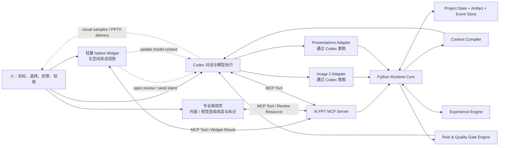

# AI PPT Studio Agent 原生工作台｜系统详细设计 v1.6

## 1. 文档信息

- 版本：v1.6
- 日期：2026-08-08
- 权威产品输入：[01-产品需求基线-v1.0.md](./01-产品需求基线-v1.0.md)
- 内容生产专项输入：[2026-08-05-content-production-multi-agent-design.md](./产品代码/docs/superpowers/specs/2026-08-05-content-production-multi-agent-design.md)
- 多智能体总体输入：[2026-08-05-content-visual-multi-agent-governance-design.md](./产品代码/docs/superpowers/specs/2026-08-05-content-visual-multi-agent-governance-design.md)
- 视觉设计专项输入：[2026-08-05-visual-production-multi-agent-design.md](./产品代码/docs/superpowers/specs/2026-08-05-visual-production-multi-agent-design.md)
- 反馈与经验治理专项输入：[2026-08-05-feedback-exemplar-experience-governance-design.md](./产品代码/docs/superpowers/specs/2026-08-05-feedback-exemplar-experience-governance-design.md)
- Presentations 主导生产与目标渲染专项输入：[2026-08-06-presentations-led-production-and-target-render-governance-design.md](./产品代码/docs/superpowers/specs/2026-08-06-presentations-led-production-and-target-render-governance-design.md)
- 严格路线 B 实验与目标渲染验证输入：[2026-08-06-strict-route-b-powerpoint-target-render-validation.md](./产品代码/docs/validation/2026-08-06-strict-route-b-powerpoint-target-render-validation.md)
- 聊天、Widget 与专业审阅页 UI 专项输入：[2026-08-07-chat-and-professional-review-ui-design.md](./产品代码/docs/superpowers/specs/2026-08-07-chat-and-professional-review-ui-design.md)
- 契约优先重构与四目标验收设计：[2026-08-08-ai-ppt-studio-contract-first-rebuild-design.md](./产品代码/docs/superpowers/specs/2026-08-08-ai-ppt-studio-contract-first-rebuild-design.md)
- 产品项目根目录：`/Users/defei/Documents/我的空间/workspace/memory/产品研究/PPT大师/PPT-codex-app`
- 源码根目录：`/Users/defei/Documents/我的空间/workspace/memory/产品研究/PPT大师/PPT-codex-app/产品代码`
- 运行数据根目录：默认 `/Users/defei/Documents/AI-PPT-Workspace`
- 设计目标：在不重写现有运行时的前提下，以 Codex 聊天、轻量 Native Widget 和专业审阅页三个表面投影同一项目状态，并实现结构化认知地图、任务级上下文编译、内容/视觉隔离多智能体质量治理、反馈/案例经验进化和聊天交付闭环。
- 当前状态：`v1.6 契约优先重构与四目标强制实机验收已批准、待重新实现；旧实现和单次实验只作历史证据`

## 2. 设计依据与事实边界

### 2.1 已验证的本地事实

现有 AI PPT Studio 已实现：

- `ProjectStore`：受管项目创建和恢复；
- `StateStore`：G0–G4 顺序状态和局部重开；
- `MaterialSource`：file/directory/url/text 输入与 reference/copy 模式；
- `ArtifactStore`：不可变、带哈希的版本化产物；
- `EventStore`：追加式事件；
- `ExperienceStore`：候选经验、跨项目应用、评价、晋级、禁用和回滚；
- HTML 审阅产物；
- 路径保护、安装和隔离验收测试。

2026-08-06 已完成两类只读引用的真实验证：

- 严格路线 B 的八页对照实验按“视觉合同 → Presentations 原生首版 → Image 2 非语义资产 → Presentations 受控整合”执行，最终 QA 证明 Image 2 未改变布局、层级、业务关系或真实证据；
- 重庆机电三页锚点在 Microsoft PowerPoint for macOS 16.111.2 中完成实机导出，PPTX 导出前后 SHA-256 均为 `10f20be16d8042174eb657e29941bd96a2f3425321f77dae50c0a70a0b5fbf14`，目标渲染、模板一致性、溢出和文件完整性均通过。

上述事实只验证当前实验机制，不证明完整产品已实现、不同项目已稳定或 Windows/WPS 已兼容。

本机 Cowart 0.1.20 验证了当前环境可行的 Native Widget 模式：

- 插件包含 `.codex-plugin/plugin.json`、Skill、MCP Server 和 Widget 资源；
- Widget 可通过 MCP Server Tool 读取/保存项目状态；
- Widget 可向 Codex 发送后续用户消息；
- Widget 可更新模型可见上下文；
- Widget 可请求内嵌/全屏显示模式，并在运行时读取宿主能力；
- Widget 数据可以保存到用户项目，而不是插件目录。

### 2.2 宿主能力边界

本设计不假设以下能力永久存在：

- 固定常驻右侧栏；
- 永久顶层应用入口；
- 任意尺寸和全屏模式必然可用；
- Widget 修改状态后自动触发新模型回合；
- Widget 能直接调用 Codex 内置 Image 2 或 Presentations；
- Widget 内存和 localStorage 在重挂载后可靠保留；
- 新插件版本无需重新加载任务即可获得新 MCP Schema。

所有宿主增强能力必须运行时探测；项目文件是唯一持久真相源。

2026-08-02 已重新校验当前 Codex 官方本地手册、插件规范和本机 Cowart MCP App 参考实现。研发继续采用能力探测与降级，不把可选宿主增强能力写成硬依赖。

## 3. 架构原则

1. **AI 主导，系统治理**：AI 自主完成低风险工作，系统用状态门和质量合同限制结果。
2. **一个真相源**：项目状态、产物和版本只保存在受管项目目录；Widget、对话和 HTML 都是投影。
3. **页面与 AI 共用结构**：页面上的选择、决定、事实、推论和不确定性必须成为 AI 的结构化上下文。
4. **意图与执行分离**：Widget 负责提交意图；Codex 决定并调用 Image 2、Presentations 等当前可用能力。
5. **上下文按任务编译**：不把整个项目、所有历史和全部材料塞给模型。
6. **内容先于视觉**：G0 未通过，系统不能调度正式视觉设计。
7. **严格路线 B 原生生产**：多智能体先形成完整视觉合同，Presentations 在合同约束下同时承担原生视觉设计与 PPTX 实现；Image 2 只在原生首版检查后生成非语义资产，不成为构图或语义母版。
8. **可恢复**：长任务、网络失败、Widget 重挂载和模型中断均不得丢失上一有效版本。
9. **增量升级**：复用现有 Python 运行时和数据，不用新前端重写业务内核。
10. **能力探测与降级**：宿主能力不可用时，降级为内嵌视图、HTML 审阅或对话操作。
11. **创意角色隔离**：视觉提案角色独立生成候选，独立审美审查智能体与 PPT 工程审查智能体独立验收；同一生成角色不得自我声明通过。
12. **二元硬质量门**：审美与工程条件逐项记录 `passed / failed / not-applicable`，任何适用项失败即返工；禁止数字审美评分、加权平均和跨条件补偿。
13. **完整合同投影**：Markdown 产物保持真相源，HTML 必须完整投影整套框架、全部页面内容和合同，不得摘要、改写、截断或形成第二套内容。
14. **批量生产、逐页自治验收**：G3 后整套批量构建，每页独立验收和自动修复；仅在明确例外条件或系统限制内不收敛时暂停用户。
15. **内容生产角色隔离**：售前策略、证据、叙事和写作角色分工生产，售前/决策者/证据/叙事/表达角色独立审查；生产角色不得自我放行。
16. **场景内核分层**：稳定内容治理内核与版本化售前场景专家能力包分离；场景方法不得覆盖用户事实和已确认决定。
17. **产物式协作**：内容智能体只通过不可变、版本化结构产物协作，不通过自由群聊或未持久化上下文传递决定。
18. **内容二元硬质量门**：`must-follow` 与 `minimum-content-quality` 任一适用项失败即返工；禁止评分、平均、多数票和优点补偿。
19. **风险分级复审**：首次内部初版全量审查，高影响修改全量重审，普通修改按影响范围复审并补做整套连贯性检查。
20. **反馈先治理**：原始反馈先进入反馈治理编排智能体和专业会诊角色，形成 `FeedbackGovernanceRecord` 后才能生成内容或视觉修改集。
21. **项目修改与经验进化分离**：项目执行结果不能自动成为长期经验，用户坚持的特殊要求只成为当前项目约束。
22. **案例分层提炼**：优选、参考、成功和失败案例分别提炼偏好信号、专业机制候选和失败模式候选，不整体复制。
23. **角色化经验切片**：Experience Engine 按场景、角色和任务裁剪经验；生产与审查角色使用不同切片。
24. **专业资格门优先**：先执行事实、内容、审美和工程硬门，再用用户优选案例和个人偏好在合格方案中择优。
25. **三速进化**：当前项目快速学习、个人经验中速进化、稳定 Prompt/角色合同/场景能力包慢速版本发布。
26. **中文角色名称**：产品文档、Prompt 合同和用户界面只显示中文智能体正式名称，代码可保留不对用户展示的英文 `roleId`。
27. **目标软件是真相源**：Presentations/开发渲染只作预检；G2 锚点页和 G4 整套必须在 macOS PowerPoint、macOS WPS、Windows PowerPoint 和 Windows WPS 四个桌面目标分别实机导出并复核。
28. **四目标证据不外推**：四个目标必须引用同一个 PPTX SHA-256 并分别形成实机证据；任一目标缺失或失败均阻止 G2/G4，不能由其他目标结果推断。
29. **四门共同放行**：业务语义、视觉完成度、排版工程和目标软件渲染任一失败即拒绝新版本；智能体轮次、合同长度或局部优点不得补偿失败。
30. **三表面单真相源**：Codex 聊天、轻量 Widget 和专业审阅页只投影同一 ProjectWorkspaceState、Artifact 和 revision，不允许各自维护业务状态。
31. **认知空间与页面解耦**：五个认知空间继续作为领域导航和状态分区，不要求五个独立完整 UI；内容/视觉使用专业审阅资源，制作/交付使用轻量状态投影和聊天交付。
32. **审阅页职责最小化**：专业审阅页只读取完整投影、保存版本化标记；不得直接确认 G0/G3/G4、恢复版本、发送样张或下载 PPTX。
33. **聊天是交付通道**：视觉样张、复杂反馈、Gate 明确表达和最终 PPTX 通过 Codex 聊天承载，但消息只保存产物引用和回执，不能替代项目持久状态。

## 4. 总体架构



## 5. 组件设计

| 组件 ID | 组件 | 职责 | 主要依赖 |
|---|---|---|---|
| CMP-01 | Plugin Package | 声明插件、Skill、MCP、Widget、品牌与默认提示 | Codex 插件加载器 |
| CMP-02 | 轻量 Native Widget UI | 投影五个认知空间的当前结论、风险、待判断、成果状态和专业审阅入口 | MCP Apps bridge |
| CMP-03 | MCP Server | 对 Widget 和 Codex 暴露统一工具与资源 | Runtime Facade |
| CMP-04 | Runtime Facade | 把 MCP 契约映射到现有 Python 运行时 | Project/State/Artifact/Event Store |
| CMP-05 | Project State Store | 保存规范化项目状态、认知地图、决定和当前工作 | 本地文件系统 |
| CMP-06 | Artifact Store | 保存任务书、蓝图、样张、合同、Scene Graph、PPTX 等不可变版本 | 现有 ArtifactStore |
| CMP-07 | Event Store | 追加式记录写入、任务、决定、冲突、回滚和质量门 | 现有 EventStore |
| CMP-08 | Rule & Gate Engine | 检查业务前置、G0–G4、人工暂停和写入权限 | 状态与产物 |
| CMP-09 | Context Compiler | 为当前智能体任务生成最小充分上下文包 | 状态、规则、来源、历史 |
| CMP-10 | 智能体意图调度器 | 将页面动作转成持久化意图和 Codex 后续消息 | MCP Server、Widget bridge |
| CMP-11 | Material Engine | 导入、解析、分类、提炼、冲突和来源定位 | 现有 materials 模块 + AI |
| CMP-12 | Blueprint Engine | 编排售前策略、证据、论证、逐页内容、内部审查、定向返工、用户审阅、冻结和重开 | Artifact/Gate、Context Compiler |
| CMP-13 | Visual Engine | Visual Brief、Deck Design System、全量 Slide Visual Contract、严格路线 B Anchor Slide Set、Scene Graph、非语义资产路由 | AI、Presentations、Image 2（原生首版后可选） |
| CMP-14 | Delivery Engine | Presentations 原生批量构建、开发预检、目标 PowerPoint 实机导出、逐页四重硬验收、自动修复、整套节奏验收、G4 与交付包 | Presentations、Target Render Gate |
| CMP-15 | Experience Engine | Experience Intake、三类学习结果、角色化经验切片、应用、评价、晋级、降级与回滚 | 现有 ExperienceStore |
| CMP-16 | Review Renderer | 从权威 Markdown 生成内容/视觉完整连续 HTML 专业审阅资源，维护区块锚点和投影完整性；联系表/机器报告仅作为内部证据 | 项目产物 |
| CMP-17 | 视觉创意编排器 | 隔离调度售前视觉、艺术指导、编辑设计、信息设计、图像艺术指导、动态页面专家和独立审查角色 | Context Compiler、Visual Engine、AgentTask |
| CMP-18 | Aesthetic & Engineering Gate | 按业务语义、视觉完成度、排版工程和目标软件渲染逐项二元判定、保存证据、拒绝失败产物、批准更优秀的参考偏离 | Rule & Gate Engine、开发预检与目标渲染证据 |
| CMP-19 | Scenario Pack Registry | 管理稳定内容治理层、阅读优先售前场景能力包、角色合同、版本和适用范围 | Artifact Store、Context Compiler |
| CMP-20 | 内容多智能体编排器 | 隔离调度策略、证据、叙事、写作和审查角色，生成返工路由并控制内部可审状态 | Blueprint Engine、AgentTask、Rule & Gate Engine |
| CMP-21 | Content Quality Gate | 按三层内容合同逐项二元判定、聚合证据并生成 ContentAcceptanceRecord | Rule & Gate Engine、ContentReviewRecord |
| CMP-22 | 视觉场景能力包注册表 | 管理售前视觉场景能力包、中文角色合同、动态页面专家、Prompt 和回归案例版本 | Artifact Store、Context Compiler |
| CMP-23 | 反馈治理编排器 | 接收原始反馈、调用专业会诊、完成 F0–F3 分级、反例检查和正式治理记录 | Context Compiler、Rule & Gate Engine、Experience Engine |
| CMP-24 | 经验入口与切片编译器 | 接收反馈/案例/成败产物，提炼三类学习结果并按场景、角色和任务编译经验切片 | ExperienceStore、Context Compiler |
| CMP-25 | Target Render Gate | 调度或登记目标 PowerPoint 实机导出，校验环境、字体、哈希、导出物和逐页结论，控制 G2/G4 放行 | Delivery Engine、Artifact/Event Store |
| CMP-26 | Review Surface Router | 选择右侧宿主浏览区、宽屏扩展或独立页面降级，并保证三种视口使用同一审阅资源和 revision | MCP Apps bridge、capability detection |
| CMP-27 | Chat Delivery Coordinator | 将视觉样张、PPTX 和必要说明发送到 Codex 聊天，记录消息/产物引用与 G0/G3/G4 用户结果 | Codex、Artifact/Event Store |

组件间只能通过明确对象和工具契约通信。Widget 和专业审阅页不直接读写项目文件；聊天消息不成为业务真相源；MCP Server 不直接实现 PPTX 引擎；Skill 不保存项目状态。

## 6. 插件与目录结构

### 6.1 源码仓库目标结构

```text
PPT-codex-app/
├── 00-唯一研发基线索引-v1.0.md
├── 01-产品需求基线-v1.0.md
├── 02-系统详细设计-v1.0.md
├── 03-UI设计与交互规范-v1.0.md
├── AGENTS.md
└── 产品代码/
    ├── AGENTS.md
    ├── prototypes/
    ├── .codex-plugin/
    │   └── plugin.json
    ├── .mcp.json
    ├── skills/
    │   └── ai-ppt-studio/
    │       ├── SKILL.md
    │       ├── references/
    │       └── assets/
    ├── mcp/
    │   ├── server.mjs
    │   ├── tools/
    │   ├── resources/
    │   └── runtime-bridge/
    ├── widget/
    │   ├── src/
    │   ├── public/
    │   └── dist/
    ├── src/ai_ppt_studio/
    ├── schemas/
    ├── docs/superpowers/
    └── tests/
```

现有 `skill/ai-ppt-studio` 在迁移期继续保留。插件正式包建立后，只保留一个权威 Skill 源并由构建脚本复制，禁止维护两份手工内容。

### 6.2 运行数据结构

```text
AI-PPT-Workspace/
├── workspace.json
├── projects/
│   └── <project-slug>-<id>/
│       ├── project.json
│       ├── sources/
│       ├── managed-assets/
│       ├── cognition/
│       │   ├── mission.json
│       │   ├── map.json
│       │   ├── decisions.jsonl
│       │   └── uncertainties.json
│       ├── blueprint/
│       ├── visual/
│       ├── scene-graph/
│       ├── ppt/
│       ├── renders/
│       ├── reviews/
│       │   ├── projections/
│       │   ├── mark-sets/
│       │   └── chat-delivery-receipts.jsonl
│       ├── state/
│       │   ├── state.json
│       │   ├── active-task.json
│       │   └── ui-projection.json
│       ├── events/
│       └── logs/
├── personal-memory/
├── inspiration-pool/
├── evaluation/
└── cache/
```

`cognition/` 与 `state/ui-projection.json` 是本次升级新增；旧项目没有时由迁移器生成，不能破坏旧文件。

### 6.3 技术栈决策

本次升级采用：

- Widget：React + TypeScript + Vite，构建为可内联的静态 HTML/CSS/JS 资源；
- Widget 样式：CSS Variables + 项目自有轻量组件，不引入完整 UI 框架；
- MCP Server：Node.js ESM + Model Context Protocol SDK / MCP Apps 扩展；
- 业务运行时：保留现有 Python 包 `ai_ppt_studio`；
- Schema：JSON Schema，Widget、MCP 和 Python 共享同一版本化契约；
- Python 测试：pytest；
- Widget 单元/组件测试：Vitest + Testing Library；
- MCP 契约测试：Node test/Vitest；
- 浏览器交互与截图：Playwright；
- PPTX 执行：Codex Presentations，不增加 `python-pptx` 或浏览器端 PPT 引擎。

生产插件不启动本地 Web Server。MCP Server 注册并返回已构建的 Widget 资源；本地 HTTP 只允许用于开发调试和截图验收。

### 6.4 Node 与 Python 边界

Node 负责 Codex/MCP/Widget 协议，Python 负责领域状态、路径、版本、规则和持久化。Phase A 使用最小可靠边界：

1. Node 将经过 Schema 校验的请求作为 JSON 传给专用 Python bridge command；
2. Python 调用现有 store/facade 并只向 stdout 输出一个结构化 JSON 结果；
3. stderr 仅用于诊断，错误转换为稳定 error code；
4. 每次写入由 Python 完成文件锁、revision 校验、原子写和事件追加；
5. Node 不复制业务规则，也不直接修改项目 JSON；
6. 大材料和模型任务由 Codex AgentTask 承担，不在 MCP 调用中阻塞执行。

先采用短生命周期 subprocess，保持实现简单、失败隔离和兼容现有 CLI。只有真实性能测试证明启动开销成为瓶颈时，才升级为长驻 worker；不得在 Phase A 预建复杂进程池。

## 7. 统一项目状态模型

### 7.1 ProjectWorkspaceState

```json
{
  "schemaVersion": "2.0",
  "projectId": "uuid",
  "revision": 42,
  "updatedAt": "ISO-8601",
  "activeSpace": "overview",
  "activeSurface": "chat|widget|professional-review",
  "activeGate": "G0",
  "missionRef": "artifact://mission/v3",
  "cognitionMapRef": "cognition/map.json",
  "gateState": {},
  "artifactHeads": {},
  "activeTask": {},
  "deliveryStatus": {},
  "reviewProjectionState": {},
  "chatDeliveryStatus": {},
  "uiProjection": {},
  "lastHumanDecisionId": "decision-id"
}
```

### 7.2 CognitionMap

认知地图是 AI 对交付任务的外化、可审计模型，不保存隐藏思维链。包含：

| 字段 | 含义 |
|---|---|
| deliveryGoal | 要交付什么并促成什么结果 |
| audiences | 主要决策者、评审者、影响者和潜在否决者 |
| problems | 当前需要解决的问题及其类型 |
| facts | 用户事实和来源引用 |
| aiJudgments | AI 当前推论、依据、置信度、版本和更新时间 |
| recommendations | 建议动作、预期影响和可撤销性 |
| confirmedDecisions | 用户已确认决定及其范围 |
| uncertainties | 尚未澄清事项、影响范围和阻断级别 |
| affectedArtifacts | 哪些蓝图、页面、视觉合同或交付物受影响 |
| outcomeStatus | 当前成果、质量门和是否在轨 |
| dialogueFocus | 当前最值得讨论的一个认知节点 |

### 7.3 认知节点统一结构

```json
{
  "nodeId": "uuid",
  "type": "fact|inference|recommendation|decision|uncertainty|outcome",
  "title": "string",
  "summary": "string",
  "status": "active|confirmed|superseded|resolved|blocked",
  "confidence": 0.0,
  "sourceRefs": ["source://..."],
  "artifactRefs": ["artifact://..."],
  "dependsOn": ["node-id"],
  "affects": ["node-id", "artifact://..."],
  "createdBy": "user|ai|system",
  "confirmedBy": "user|null",
  "revision": 1,
  "updatedAt": "ISO-8601"
}
```

事实不要求 confidence；AI 推论必须有依据与 confidence；用户决定必须保存原始表达和结构化解释。

## 8. 核心对象详细契约

### 8.1 MissionBrief

必填：

- `topic`；
- `primaryAudience`；
- `desiredJudgmentOrAction`。

可选但必须显示未知影响：

- maker、secondaryAudiences、decisionStage、meetingMode、timeLimit、pageRange、brand、confidentiality、language、deliveryEnvironment、knownConsensus、openQuestions、concerns、competition、previousFeedback、redLines。

状态：`draft -> confirmable -> confirmed -> reopened -> superseded`。

### 8.2 MaterialSource / MaterialFinding

MaterialSource 复用现有 `kind/mode/original_ref/managed_ref/sha256/size/created_at`，新增：

- accessStatus；
- contentSnapshotRef；
- publisher/title/date/updatedAt/readAt；
- permissionScope；
- inferredPurposes[]；
- parseStatus；
- lastValidSnapshotRef。

MaterialFinding：

- findingId、findingType、content、sourceRef、locator、authorityLevel、confidence、factStatus、usableInSlides[]、conflictsWith[]、sanitizedReusableAssetRef。

### 8.3 ContentBlueprint / SlidePlan

ContentBlueprint：objective、audienceModel、persuasionLine、narrativePerspective、chapterOrder、strategyRef、claimEvidenceMapRef、argumentMapRef、slideDraftSetRef、acceptanceRecordRef、slides[]、version、status、sourceCoverage、openIssues。

SlidePlan：

- slideId、order、chapterId、title；
- communicationGoal、coreClaim、visibleCopy、speakerNotes；
- factRefs、caseRefs、screenshotRefs、dataRefs；
- aiConnectiveContent；
- contentStatus；
- gaps、conflicts、downstreamImpact；
- confirmedBy、confirmedAt。

### 8.4 内容生产与场景对象

`PresalesScenarioPack`：

- `packId`、`version`、`status`、`appliesTo[]`、`supersedes`；
- `taskModel`、`audienceDecisionModels[]`、`commonObjections[]`、`evidencePreferences[]`；
- `argumentMethods[]`、`professionalLanguageRules[]`、`forbiddenPatterns[]`、`referenceExamples[]`；
- `qualityRuleRefs[]`、`roleContractRefs[]`、`regressionCaseRefs[]`、`releaseNotes`。

`PresalesContentStrategy`：

- `missionRef`、`scenarioPackRef`、`decisionStage`、`audiencePriorities[]`；
- `coreTension`、`decisionObjective`、`persuasionProposition`、`objections[]`；
- `solutionBoundary`、`evidenceRequirements[]`、`redLines[]`、`openIssues[]`、`revision`。

`ClaimEvidenceMap`：

- `claims[]`：claimId、content、importance、factStatus、evidenceRefs[]、evidenceStrength、conflicts[]、gaps[]、affectedSlides[]；
- `unusedRelevantEvidence[]`、`unsupportedCriticalClaims[]`、`overclaimWarnings[]`、`coverageSummary`、`revision`。

`DeckArgumentMap`：

- `strategyRef`、`claimEvidenceMapRef`、`chapters[]`、`slideNodes[]`、`argumentEdges[]`；
- 每个页面节点包含 communicationTask、coreClaim、proofRole、dependsOn、leadsTo、necessityReason、densityRisk；
- `duplicateRisks[]`、`logicBreaks[]`、`revision`。

`SlideDraftSet` 聚合全部 SlidePlan，并增加 `strategyVersion`、`evidenceVersion`、`argumentVersion`、`draftStatus` 和 `revision`。

### 8.5 内容审查、返工与修改对象

`ContentReviewRecord`：

- `targetRef`、`reviewerRole`、`roleContractVersion`、`scenarioPackVersion`、`inputVersion`；
- `checks[]`：criterionId、level、applicability、result、evidenceRefs[]、failureReason、repairInstruction、targetRefs[]；
- `overallResult` 只允许 `passed|failed`；任一适用 `must-follow` 或 `minimum-content-quality` 失败时必须为 `failed`；
- `reviewedAt`、`iteration`、`supersedes`。

`ContentRepairPlan`：issueIds[]、deduplicatedFailures[]、ownerRoleByIssue、targetRefs[]、preserveRefs[]、requiredOutcome、reviewRoute[]、revision。

`ContentAcceptanceRecord`：targetRef、inputVersions、reviewRecordRefs[]、allApplicableChecks[]、overallResult、referenceDeviations[]、passedAt、iteration、supersedes。禁止 score、rating、average、weightedScore、voteCount 等字段。

`ContentChangeSet`：feedbackGovernanceRecordRef、governedIntent、targetRefs[]、preserveRefs[]、factImpact、strategyImpact、pageCountImpact、downstreamImpact[]、requiredRoleRuns[]、reviewRoute[]、revision。原始用户反馈不得绕过 `FeedbackGovernanceRecord` 直接进入本对象。

### 8.6 VisualBrief / CreativeDeliberationRecord

VisualBrief：audienceFit、desiredPerception、designProposition、narrativeRhythm、visualGrammar、typographyIntent、colorIntent、imageryStrategy、diagramStrategy、brandConstraints、deliveryEnvironment、pptConstraints、avoidList。

CreativeDeliberationRecord 必须包含：

- `roleRuns[]`：售前视觉策略、视觉艺术指导、编辑设计、信息设计、图像艺术指导、动态页面专家、独立审美和 PPT 工程审查的运行 ID、中文角色名称、稳定 roleId、输入版本、输出产物引用和时间；
- `candidateRefs[]`：内部候选方案引用；候选不直接形成用户待选任务；
- `decisionSummary`：最终采用/拒绝的外化结论；
- `evidenceRefs[]`：可审计的原生构图候选、开发预检、目标 PowerPoint 导出、规则检查和失败证据；正式路线不得把 Image 2 整页图作为设计母版证据；
- `revisionRequests[]`：明确到合同区块或页面的返工要求；
- `convergenceStatus`：`running|passed|failed-to-converge`；
- `iterationCount`、`limitPolicyRef`、`revision`。

系统不得保存或向用户展示隐藏思维链。只保存结论、理由摘要、证据、规则判定、版本和返工指令。

视觉角色 Context Pack 必须记录 `productionRoute=strict-B`、`stableVisualGovernanceVersion`、`presalesVisualScenarioPackVersion`、`roleContractVersion`、`taskContractVersion`、`toolPromptPackVersion`、`experienceSliceVersion` 和 `repairInstructionVersion`。路线 A/C 仅可在显式实验项目中使用独立 Context Pack，禁止读取路线 B 或彼此产物。

### 8.7 DeckDesignSystem / SlideVisualContract / VisualContract

DeckDesignSystem 必须包含：

- `themeProposition`、`audiencePerception`、`designPrinciples`；
- `narrativeRhythm`、`pageFamilies`、`familyVariationRules`、`antiRepetitionRules`；
- `gridAndCompositionGrammar`、`safeArea`、`alignment`、`whitespace`、`visualHierarchy`；
- `typographyTokens`、`colorTokens`、`contrastRules`、`accentBudget`；
- `imageryStrategy`、`diagramStrategy`、`chartStrategy`、`tableStrategy`；
- `densityRules`、`transitionRules`、`footerAndPaginationRules`；
- `nativePreferred`、`bitmapAllowed`、`editableTargetByObjectType`；
- `replacementAndFallbackRules`、`forbiddenPatterns`；
- `productionRoute` 固定为 `strict-B`，以及 Presentations 可自主实现范围、Image 2 非语义资产边界和目标软件/平台要求；
- `ruleDefinitions[]`，每条规则含 `ruleId`、`level`、`condition`、`expectedOutcome`、`evidenceMethod`。`level` 只允许 `must-follow|minimum-aesthetic|reference-implementation`。

SlideVisualContract 必须逐页包含：

- `slideId`、`order`、`chapter`、`pageFamily`、`communicationGoal`、`coreClaim`；
- 从 G0 内容蓝图逐字绑定的 `title`、`subtitle`、`visibleCopy[]`、`labels[]`、`footer`、`speakerNotes`；
- `sourceRefs[]`、`materialRefs[]`、`assetRefs[]` 及其页面用途；
- `informationHierarchy`、`compositionIntent`、`regions[]`、`objectRelationships[]`、`readingOrder`；
- `imageSelectionAndCrop`、`diagram/chart/table treatment`、`typographyApplication`、`colorApplication`；
- `nativeBitmapRouting`、`editabilityRequirements`、`fallbacks`、`allowedExceptions`；
- `acceptanceCriteria[]`，每项引用 DeckDesignSystem 的规则、适用性和所需证据；
- `contractStatus`、`revision`。

VisualContract 是 `deckDesignSystemRef + slideContractRefs[] + anchorSlideSetRef + acceptanceRecordRefs[] + reviewProjectionRef` 的版本化聚合。只有 G3 用户整体确认后设置 `frozenAt / frozenBy`；G1/G2 通过不等于用户冻结。

### 8.8 AnchorSlideSet / AestheticAcceptanceRecord / ReviewProjection

AnchorSlideSet：

- 固定包含 2–3 页真实可编辑 PPTX 锚点页；
- 覆盖关键页面家族、视觉高难页和内容复杂页；
- 必须先形成不依赖 Image 2 整页结果的 Presentations 原生首版；非语义资产增强是可选后置阶段；
- 保存 `slideIds[]`、`nativeFirstPptxRef`、`nativeFirstRenderRefs[]`、`imageAssetPackRef`、`finalPptxRef`、`preflightRenderRefs[]`、`targetRenderEvidenceRef`、`editabilityEvidenceRefs[]`、`coveredRisks[]`、`revision`。

AestheticAcceptanceRecord：

- `targetRef`、`targetType`、`reviewerRole`、`inputVersion`；
- `checks[]`：`criterionId`、`applicability`、`result`、`evidenceRefs[]`、`failureReason`、`repairInstruction`；
- `overallResult` 只允许 `passed|failed`；任一适用检查 `failed` 时 overallResult 必须为 `failed`；
- `referenceDeviation`：仅对 `reference-implementation` 使用，记录更优秀实现的偏离点、未破坏的硬要求、最低审美结果和放行证据；
- `reviewedAt`、`iteration`、`supersedes`。

禁止字段：`score`、`rating`、`weightedScore`、`average` 或任何等价数字审美分。

ReviewProjection：

- `sourceMarkdownRefs[]`、`sourceVersions[]`、`htmlRef`、`generatedAt`；
- `reviewType` 只允许 `content|visual`，以及 `displayPolicy=professional-review`；
- `deckOutlineAnchor`、`designSystemAnchor`、`slideAnchors{}`、`contractBlockAnchors{}`；
- `commentThreads[]`：targetRef、anchor、rawText、status、createdAt、resolvedByVersion；
- `sampleEvidenceRefs[]` 只保存聊天样张消息/产物身份，不在专业审阅页生成视觉样张画廊；
- 完整性校验：源字段计数/哈希、投影字段计数/哈希、禁止省略标记扫描、可见性检查。

`ReviewMarkSet`：

- `markSetId`、`projectId`、`reviewType`、`sourceVersion`、`revision`；
- `status`：`draft|saved|pending-governance|governed|resolved`；
- `marks[]`：markId、targetAnchor、selectedText、comment、createdAt；
- 保存时必须带 `expectedRevision`；锚点或源版本冲突时不得静默迁移或覆盖；
- `saved` 只表示持久化成功，不等于 G0/G3 确认，也不得直接生成稳定经验。

HTML 只读投影权威 Markdown；用户标记以 ReviewMarkSet 写回项目，不直接把 HTML 变成真相源。版本历史继续由 Artifact Store 保存，但专业审阅 Header 不显示历史入口。

### 8.9 SlideSceneGraph

每页包含：

- semantic role；
- viewport / safe area；
- objects[]；
- parent/child、alignment、readingOrder、zOrder、anchors、constraints；
- content refs、source refs、asset refs；
- object role：native-required / native-preferred / controlled-bitmap / forbidden；
- editability、replaceability、crop behavior；
- accessibility label；
- render fallback；
- validation rules。

场景图是可控中间表示，不要求用户编辑，也不替代 PPTX。

### 8.10 视觉 Prompt 与工具任务包

`VisualAgentContextPack`：

- stableVisualGovernanceRef、presalesVisualScenarioPackRef、projectContextRef；
- productionRoute（正式项目固定 `strict-B`）、targetApplication、productionPlatform、crossPlatformTargets[]；
- roleId、roleDisplayName、roleContractRef、taskContractRef；
- g0ContentRefs[]、targetSlideRefs[]、materialRefs[]；
- experienceSliceRef、toolPromptPackRef、repairInstructionRef；
- outputSchemaRef、validationRuleRefs[]、explicitExclusions[]、revision。

`NativeVisualDesignBrief`：正式路线 B 的 Presentations 设计执行合同，包含完整冻结内容、视觉命题、页面家族、构图与信息目标、可自主实现范围、原生/位图边界、目标软件/平台、字体与替代策略、禁止项、验收条件和版本。

`VisualExplorationPromptPack`：只用于明确标记的路线 A/C 隔离实验，包含实验目标、输入边界、禁止读取路线、结果用途和版本；不得成为正式路线 B 的前置输入或设计母版。

`ImageAssetPromptPack`：只在原生首版冻结后生成非语义资产，包含用途、目标页面、尺寸、主体、构图、裁切安全区、风格、禁止文字/数字/符号/业务关系/真实证据冒充、来源/隐私边界、原生首版引用和版本。

`AnchorSlideEngineeringBrief`：完整内容、对象关系、原生/位图路由、编辑要求、字体、网格、素材、替代规则、验收条件、版本。

`VisualRepairInstruction`：失败条件、目标对象、保持不变项、期望结果、上一有效版本、复验角色、版本。

`VisualChangeSet`：feedbackGovernanceRecordRef、governedIntent、targetRefs[]、preserveRefs[]、designSystemImpact、pageFamilyImpact、slideImpact[]、engineeringImpact、requiredRoleRuns[]、reviewRoute[]、revision。

### 8.11 PresentationBuild / TargetRenderEvidence

`PresentationBuild`：

- `buildId`、`productionRoute`、`visualContractRef`、`nativeVisualDesignBriefRef`、`inputVersions[]`；
- `nativeFirstPptxRef`、`nativeFirstRenderRefs[]`、`nativeFirstReviewRefs[]`；
- `imageAssetPackRef`、`assetIntegrationChanges[]`、`finalPptxRef`；
- `preflightEnvironment`、`preflightRenderRefs[]`、`preflightCheckRefs[]`；
- `targetRenderEvidenceRef`、`qualityGateRefs[]`、`repairHistoryRefs[]`、`lastValidBuildRef`、`revision`。

`TargetRenderEvidence`：

- `targetApplication` 固定记录 Microsoft PowerPoint 桌面版或另行明确的独立兼容目标；
- `operatingSystem`、`operatingSystemVersion`、`applicationVersion`、`exportedAt`；
- `fontInventoryRef`、`fontSubstitutionPlanRef`、`platformSpecificFontRisks[]`；
- `sourcePptxRef`、`sha256Before`、`sha256After`、`exportRefs[]`、`pageImageRefs[]`；
- `slideChecks[]`：slideId、semanticResult、aestheticResult、engineeringResult、targetRenderResult、evidenceRefs[]、failureReason、repairInstruction；
- `overallResult` 只允许 `passed|failed`；对象消失、错位、字体替换、裁切、异常换行、溢出或设计意图明显掉级任一出现时必须为 `failed`；
- `requiredTargetProfiles[]` 固定包含 `macos-powerpoint`、`macos-wps`、`windows-powerpoint`、`windows-wps`；`compatibilityClaims[]` 只能由四目标各自同哈希实机证据生成。

开发/Presentations 渲染产物必须标记 `preflight-only`，不得填入 `TargetRenderEvidence` 伪装实机证据。

`ChatDeliveryReceipt`：

- `receiptId`、`projectId`、`deliveryType`（`visual-sample|comparison|pptx|preview|delivery-note`）；
- `artifactRefs[]`、`artifactVersions[]`、`messageRef`、`sentAt`、`sendStatus`、`retryOf`；
- 样张必须记录 `slideIds[]`、样张身份和待判断问题；PPTX 必须记录 buildId、G4 前置状态和文件哈希；
- `userOutcome` 只记录用户在聊天中的明确接受、修改或继续讨论；消息关闭、文件下载或审阅页保存不得推断为 Gate 通过；
- 消息通道失败只重试发送，不重新构建已有通过产物。

### 8.12 反馈治理与经验对象

`FeedbackGovernanceRecord`：

- recordId、version、status、rawFeedback、author、targetRefs[]、targetVersion、triggerEvidenceRefs[]；
- observedSymptom、underlyingIntent、diagnosis、rootCause、domainReviewRuns[]、evidenceRefs[]、overgeneralizationRisk；
- feedbackLevel (`F0|F1|F2|F3`)、scope、preserveRefs[]、counterexamples[]、exceptions[]、failureConditions[]；
- aiRecommendation、alternatives[]、directExecutionCost、governedRule、requiresUserDecision；
- userDecision、decisionReason、changeSetRefs[]、appliedArtifactRefs[]、professionalReviewRefs[]、beforeAfterEvidenceRefs[]、userOutcome；
- learningEligibility、eligibilityReason、sanitizedMechanism、applicabilityScope、experienceRefs[]。

状态固定为：

```text
captured
-> under-review
-> governed
-> needs-user / executable
-> applied
-> professionally-validated
-> user-accepted / rejected
-> learning-eligible / project-only
-> closed
```

`PreferenceSignal`：sourceRefs[]、positiveOrNegative、preferenceStatement、scope、conditions[]、counterexamples[]、confidenceInputs、version。

`ProfessionalMechanismCandidate`：mechanism、sourceRefs[]、scenes[]、audiences[]、slideTasks[]、conditions[]、evidenceRefs[]、counterexamples[]、failureConditions[]、privacyBoundary、version。

`AntiPatternCandidate`：pattern、symptoms[]、rootCauses[]、scopes[]、negativeEvidenceRefs[]、repairMechanisms[]、exceptions[]、version。

`RoleSpecificExperienceSlice`：targetRoleId、targetRoleDisplayName、taskType、targetContext、experienceVersionRefs[]、matchReasons[]、confidenceInputs、excludedExperienceRefs[]、compiledAt、revision。

经验入口必须区分项目执行状态与经验进化状态。错误场景应用、未评价修改和仅在测试中模拟成功的记录不得计入真实晋级证据。

### 8.13 AgentTask

```json
{
  "taskId": "uuid",
  "type": "classify-materials|build-presales-strategy|map-claim-evidence|build-argument-map|draft-slide-content|review-presales|review-decision-maker|review-content-evidence|review-narrative|review-editorial|repair-content|accept-content-internally|deliberate-design|review-aesthetic|review-information-design|review-editorial-reading|review-engineering|build-anchor-slides|review-native-first|generate-nonsemantic-assets|integrate-nonsemantic-assets|export-target-render|review-target-render|render-contract-review|govern-feedback|review-feedback-counterexample|extract-experience|review-experience-fit|compile-experience-slice|build-pptx|qa-slide|qa-deck|repair",
  "projectId": "uuid",
  "requestedBy": "widget|codex|system",
  "expectedRevision": 42,
  "contextPackRef": "context/task-id.json",
  "inputRefs": [],
  "status": "queued|running|needs-user|partial|failed|cancelled|completed",
  "progress": {"stage":"rendering","done":18,"total":24},
  "resultRefs": [],
  "error": null,
  "retryCount": 0,
  "createdAt": "",
  "updatedAt": ""
}
```

## 9. 写入优先级与所有权

统一写入优先级：

1. 最新明确的用户决定；
2. 交付任务与成功标准；
3. 系统规则、状态门与质量合同；
4. 已确认事实和决定；
5. 来源证据；
6. AI 推论和建议；
7. 历史版本和会话摘要。

AI 不得覆盖更高优先级信息，只能提出冲突或生成新版本。页面不直接写产物文件，必须调用 MCP 工具并提供 `expectedRevision`。

## 10. MCP Server 契约

### 10.1 Widget 资源

`render_ai_ppt_workbench`

- 输入：projectRoot 或 projectId、initialSpace；
- 输出：五个认知空间轻量状态投影的 MCP App resource；
- `_meta.widgetData`：初始项目快照、允许动作、能力标志和资源 URL；
- 不包含全部材料正文或完整历史。

`render_ai_ppt_review`

- 输入：projectId、reviewType（content|visual）、sourceVersion、requestedDisplayMode；
- 输出：同一响应式专业审阅资源，优先请求右侧宿主浏览区，可扩展宽屏或降级为独立页面；
- `_meta.widgetData`：投影引用、revision、目录/标记状态、允许动作和宿主能力；
- 允许动作只包括读取、切换内容/视觉、定位、创建标记和保存标记；不得包含返回聊天、版本恢复、Gate 确认或 PPTX 下载。

### 10.2 读工具

| 工具 | 输入 | 输出 |
|---|---|---|
| get_project_snapshot | projectId, projection, sinceRevision? | 任务级或页面级快照 |
| get_cognition_map | projectId, nodeTypes?, depth? | 认知节点与依赖 |
| list_materials | projectId, filter, cursor | 材料和提炼摘要 |
| get_content_blueprint | projectId, view?, chapterId?, slideId?, version? | 内容生产状态、策略/证据/论证、结构或全文审阅、审查/返工记录和过程版本投影 |
| get_visual_workspace | projectId, slideId?, contractVersion? | Visual Brief、内部门状态、Deck Design System、全量页面合同、锚点页、批注和完整审阅投影 |
| get_delivery_review | projectId, buildId? | 正式路线、原生首版、非语义资产、开发预检、目标 PowerPoint 实机证据、问题和交付门 |
| get_delivery_status_projection | projectId, buildId? | Widget 所需的阶段、完成数、四门、最高影响阻断、平台证据和聊天发送状态；不返回全量联系表/大图 |
| get_feedback_governance | projectId, recordId?, targetRef?, status? | 原始反馈、F0–F3、专业诊断、AI 建议、用户决定、执行和经验资格投影 |
| get_experience_intake | projectId?, sourceType?, resultType?, status? | 反馈/案例来源、三类学习结果、经验切片和应用评价摘要 |
| get_artifact_version | artifactRef | 指定不可变版本 |
| list_project_events | projectId, afterCursor? | 增量事件 |

### 10.3 写工具

| 工具 | 核心输入 | 副作用 |
|---|---|---|
| patch_project_state | projectId, expectedRevision, patch, reason | 原子写入新 revision，追加事件 |
| submit_human_decision | projectId, targetRef, choice/feedback, expectedRevision | 创建决定、更新认知图、计算影响范围 |
| request_agent_action | projectId, actionType, targetRefs, instructions | 创建 AgentIntent/Task，返回 followUpMessage |
| append_feedback | projectId, scope, rawText, targetVersion, triggerEvidenceRefs? | 保存 RawFeedback 并创建反馈治理任务，不直接生成 ContentChangeSet/VisualChangeSet |
| save_review_marks | projectId, reviewType, sourceVersion, marks[], expectedRevision | 批量保存 ReviewMarkSet，返回保存数量、新 revision 和 pending-governance 状态；不确认 Gate |
| submit_feedback_decision | projectId, governanceRecordId, choice, note?, expectedRevision | 保存 F2/F3 用户裁决，更新治理记录并允许生成对应修改集 |
| register_experience_source | projectId?, sourceType, sourceRefs, userLabel?, privacyBoundary | 登记优选/参考案例、成功/失败成品或内审失败到 Experience Intake |
| evaluate_experience_application | applicationId, professionalReviewRefs, userOutcome, evidenceRefs | 记录匹配应用的专业复审和用户结果，不允许错误场景应用计入晋级 |
| confirm_gate | projectId, gate, evidenceRefs, expectedRevision, userMessageRef | 仅允许 Codex 基于用户在聊天中的明确表达确认 G0/G3/G4；专业审阅保存、关闭或文件下载不得调用 |
| record_internal_gate | projectId, gate, reviewerRole, acceptanceRecordRefs, expectedRevision | 仅允许独立审美/PPT 工程角色记录 G1/G2 二元结果 |
| record_target_render_evidence | projectId, gate, buildId, evidenceRef, expectedRevision | 登记 G2/G4 目标 PowerPoint 实机证据；拒绝把开发预检渲染登记为目标证据 |
| record_chat_delivery | projectId, deliveryType, artifactRefs, messageRef, expectedRevision | 保存视觉样张/PPTX/预览/说明的聊天交付回执，不把消息内容作为唯一真相源 |
| reopen_scope | projectId, gate, artifactRefs, reason | 局部重开、锁定下游受影响部分 |
| cancel_agent_task | projectId, taskId | 标记取消，保留已完成产物 |
| restore_artifact_version | projectId, artifactRef, reason | 创建指向旧内容的新版本，不改历史 |

### 10.4 响应约定

每个工具返回：

- `structuredContent`：Codex 可读的精简结果；
- `_meta.widgetData`：Widget 更新需要的投影；
- `revision`；
- `eventCursor`；
- `allowedNextActions`；
- `conflict` 或 `userAttention`（如有）。

错误不使用自由文本作为唯一判断依据，必须返回稳定 error code。

## 11. 双向回写机制

### 11.1 Widget → 项目状态

1. 用户在 Widget 中选择认知空间、提交轻量判断或打开专业审阅；
2. Widget 调用 MCP 写工具，携带当前 revision；
3. MCP Server 校验权限、规则和版本；
4. Runtime 原子写入状态/产物，追加事件；
5. 返回新投影；
6. Widget 更新页面；
7. 如果动作需要 AI 执行，Widget 使用返回的 follow-up message 发送到 Codex；打开专业审阅则交给 Review Surface Router，不在 Widget 内复制全文。

### 11.2 Widget → 模型上下文

页面状态变化本身不等于模型已开始工作。

- `updateModelContext`：用于把当前选择、活动对象和认知焦点提供给当前模型上下文；失败不影响持久状态；
- `sendFollowUpMessage`：用于明确触发一个新的 Codex 用户回合；
- 任何调用前先保存持久状态；
- 宿主不支持时显示“状态已保存，可继续在 Codex 聊天中处理”，不得提供伪造的返回按钮，也不得假装 AI 已开始。

### 11.3 Codex → 项目状态

1. Codex 读取 AgentTask 的 Context Pack；
2. 调用 Image 2/Presentations/文件工具完成工作；
3. 将产物写入受管项目；
4. 调用 MCP/Runtime 提交结果、问题和质量状态；
5. 状态写入新 revision 并追加事件；
6. Widget 通过 tool result、增量刷新或重新打开获取更新。

### 11.4 冲突

使用乐观并发控制：

- 每个写入携带 `expectedRevision`；
- 不匹配时返回 `REVISION_CONFLICT` 和最新投影；
- 不自动覆盖用户决定；
- 非重叠 UI 偏好可自动重放；
- 同一业务对象冲突要求 AI 合并建议或人工选择。

### 11.5 专业审阅页 → 项目状态

1. 页面从 `render_ai_ppt_review` 获取固定 sourceVersion、revision 和完整 ReviewProjection；
2. 目录、阅读位置和未保存草稿属于当前 UI 实例临时状态，不成为项目真相；
3. 用户点击右上角 `保存标记` 后调用 `save_review_marks`；
4. Runtime 校验 sourceVersion、锚点和 expectedRevision，原子保存 ReviewMarkSet 并追加事件；
5. 保存成功只返回 `saved/pending-governance`，不调用 confirm_gate、不直接改合同；
6. 版本或 revision 冲突时保留草稿，返回受影响标记和最新投影，由用户/AI 合并；
7. 页面不提供返回聊天、版本恢复或 Gate 确认工具。

### 11.6 Codex 聊天交付与 Gate 回写

1. Codex 发送样张或交付文件前读取当前项目与 Artifact 版本；
2. 发送成功后调用 `record_chat_delivery`，保存消息与产物引用；
3. 用户在聊天中明确接受或修改后，Codex 将原始消息引用写入 HumanDecision；
4. 只有明确接受且 Gate 前置证据齐全时调用 `confirm_gate(G0|G3|G4)`；
5. 修改意见先进入反馈治理，再按影响范围重开；
6. 审阅页关闭、标记保存、文件下载或消息已读均不得推断为用户确认。

## 12. Context Compiler

### 12.1 目标

每个 AgentTask 获得“最小充分上下文”，而不是全部项目文件。

### 12.2 Context Pack 结构

```text
1. Stable governance layer and versions
2. Scenario pack subset and version
3. Role contract and isolation rules
4. Task objective, target refs and expected deliverable
5. Current gate and allowed transitions
6. Mission and audience subset
7. Confirmed facts and decisions
8. Evidence/source excerpts required for this task
9. Current artifact contract and target version
10. Active uncertainties and impact
11. Production route, target application/platform, font and compatibility requirements
12. Role-specific experience slice with versions, scope, confidence inputs and match reasons
13. Repair requirements and preserve refs, only for repair tasks
14. Output schema, validation and write-back instructions
15. Explicit exclusions
```

### 12.3 编译规则

- 先按 taskType 路由，再按 targetRefs 收集；
- 先锁定 stable governance、scenario pack、role contract 和 task contract 的版本，再收集项目上下文；
- 只包含关联事实和来源摘录；
- 历史只包含上一有效版本与当前差异；
- 用户原始决定优先于会话摘要；
- 内容生产角色不接收审查结论，审查角色不接收生产侧自我评价或其他审查记录；只有独立总编接收全部 ContentReviewRecord；
- 视觉生产与审查角色分别按中文角色合同编译，生产侧与审查侧售前视觉专家不得共享运行上下文或自我评价；
- 正式视觉和制作任务固定编译 `productionRoute=strict-B`；Presentations 任务不得读取 Image 2 整页实验结果，Image 2 资产任务必须引用已冻结原生首版并声明非语义边界；
- G2/G4 任务必须同时编译 macOS/Windows 上 PowerPoint/WPS 四目标、字体清单/替代策略和同一 PPTX 哈希要求；四个目标不得按项目省略；
- 动态页面专家只有在页面家族或内容风险匹配时加载；
- 内容、视觉和工程角色只接收已治理反馈；原始反馈仅进入反馈治理任务及其专业会诊角色，并标记为待评审假设；
- Experience Engine 先按场景匹配，再按角色过滤和任务裁剪；候选经验与个人经验必须标记不同使用权限；
- 生产角色重点接收成功机制与偏好，审查/返工角色重点接收失败模式与反例；
- 返工 Context Pack 必须包含失败条件、目标范围、保持不变项和上一有效版本，不得默认重写整套；
- 每个 Context Pack 带 projectRevision、artifactVersion 和生成时间；
- Pack 保存到项目以支持复现和审计；
- 不保存隐藏思维链，只保存任务输入、外化判断和依据。

## 13. 规则与人工暂停引擎

### 13.1 影响级别

| 级别 | 示例 | 默认行为 |
|---|---|---|
| L0 只读 | 摘要、分类、查看 | 直接执行 |
| L1 可撤销低影响 | 标签、页面状态、布局微调 | 自动执行并回执 |
| L2 建议 | 下一步、内部视觉候选、内容改写 | 生成候选，可继续探索 |
| L3 高影响 | 目标、事实、页数、方案边界、G3 视觉合同意图 | 生成草稿可自主；改变用户已冻结内容或确认合同须人工确认 |
| L4 破坏性/对外 | 删除、覆盖、批量、发送、最终交付 | 强确认、权限、审计 |

### 13.2 暂停判定

暂停条件来自：影响级别、置信度、来源冲突、可撤销性、状态门、用户显式规则。

内容阶段只有以下条件可以暂停用户：权威材料关键冲突；核心主张所需证据缺失且降级/删除会改变决策主线；听众、目标、方案边界或商业承诺存在真实歧义；售前专业判断与用户明确意图冲突；分支会实质改变页数、方案范围或核心主线；内容返工在待验证的系统限制内无法收敛。暂停时只创建一个最高影响 Decision，不把整套内部失败稿转成用户待办。

视觉阶段只有以下条件可以暂停用户：业务语义仍有歧义、关键素材缺失、可编辑性与设计意图发生不可自动裁决的冲突、内部讨论或自动返工在系统限制内无法收敛。G1/G2 通过或失败本身不得触发用户逐页确认。任何单一页面不得自行改变暂停政策。

反馈治理采用独立 F0–F3 分级：

| 级别 | 系统行为 | 用户介入 |
|---|---|---|
| F0 明确局部修正 | 治理后直接生成修改集、修复和复审 | 修改结果回执 |
| F1 局部主观偏好 | 诊断根因并选择更专业的局部实现 | 前后对比和结果评价 |
| F2 跨页面/项目级规则 | 检查反例、范围、代价和替代方案 | 扩大执行前必须裁决 |
| F3 专业冲突/高影响 | 暂停执行，保护上一有效版本 | 必须显示冲突、AI 推荐和替代方案 |

F2/F3 决策只提供 `按 AI 建议修改`、`仍按我的原意见执行` 和 `补充说明`。用户坚持后的决定只成为当前项目约束；事实真实性、安全和系统硬约束不可被覆盖。

## 14. G0–G4 技术状态

现有 `StateStore` 的 gate 结构继续作为主状态机，升级后增加 gate 类型、执行者、二元结果、证据和范围：

```json
{
  "G0": {
    "status": "open|running|failed|passed|locked",
    "gateType": "user-checkpoint|internal-quality-gate",
    "scopeRefs": [],
    "evidenceRefs": [],
    "acceptanceRecordRefs": [],
    "decidedBy": ["user|aesthetic-agent|ppt-engineering-agent"],
    "decidedAt": "",
    "reopenReason": null
  }
}
```

各门固定语义：

| Gate | 类型 | 通过者 | 通过条件 |
|---|---|---|---|
| G0 | user-checkpoint | user via Codex | 策略、证据、论证、完整逐页内容和 ContentAcceptanceRecord 齐全；用户完成专业审阅后在聊天中明确确认 |
| G1 | internal-quality-gate | aesthetic-agent | 唯一视觉命题、整套节奏、页面家族和反模板化策略全部硬通过 |
| G2 | internal-quality-gate | aesthetic-agent + ppt-engineering-agent | Deck Design System、全部页面合同和 2–3 页严格路线 B 锚点页通过业务语义、视觉完成度、排版工程，并在 macOS/Windows 上 PowerPoint/WPS 四目标对同一 PPTX 哈希实机通过 |
| G3 | user-checkpoint | user via Codex | 用户完成专业审阅并保存标记后，在聊天中一次确认整套视觉合同，或提出修改后重开受影响范围 |
| G4 | user-checkpoint | user via Codex | 每页和整套均通过四重内部硬验收，整套目标 PowerPoint 实机导出、字体/平台证据与交付包齐全；Codex 发送 PPTX 后用户在聊天中接受最终成稿 |

`confirm_gate` 不得用于 G1/G2，`record_internal_gate` 不得用于 G0/G3/G4。`confirm_gate` 必须携带用户聊天消息引用，专业审阅页保存、关闭或文件下载不得代替。任何适用检查失败时 G1/G2 必须保持 `open` 或 `failed`，禁止 `conditional-pass`。

G0 继续是唯一内容用户检查点，不新增新的 G 编号。G0 内部增加 `contentProductionState` 与 `contentAcceptanceStatus`：只有 `contentProductionState=internally-passed` 且 `ContentAcceptanceRecord.overallResult=passed` 时，G0 才允许进入 `user-reviewable`；内部通过不等于用户冻结。

### 14.1 内容生产、审查与返工状态机

```text
mission/materials ready
  -> build PresalesContentStrategy
  -> build ClaimEvidenceMap
  -> build DeckArgumentMap
  -> build SlideDraftSet
  -> isolated presales / decision-maker / evidence / narrative / editorial review
  -> 独立总编智能体聚合
  -> failed: ContentRepairPlan -> targeted repair -> affected re-review + deck coherence review
  -> ContentAcceptanceRecord passed
  -> user-reviewable
  -> professional review + saved ReviewMarkSet
  -> G0 user confirmation in Codex chat
```

首版执行全量审查。变更路由固定为：

- `editorial-local`：表达审查 + 受影响页面；
- `content-local`：售前 + 证据 + 上下游逻辑；
- `structural`：售前 + 证据 + 叙事 + 表达全量；
- `high-impact`：从策略或证据阶段重开并全量审查。

任一适用 `must-follow` 或 `minimum-content-quality` 失败时不得生成 passed ContentAcceptanceRecord。表达偏好冲突由独立总编依据任务书、听众和证据裁决，不使用多数投票。

### 14.2 内部创意讨论与自动返工状态机

```text
G0 passed
  -> 售前视觉策略/视觉艺术指导/编辑设计/信息设计/图像艺术指导隔离发散
  -> 售前视觉适配/审美/信息表达/编辑阅读/PPT 工程独立质询
  -> revise / merge
  -> G1 passed
  -> Deck Design System + all Slide Visual Contracts
  -> Presentations build 2–3 native-first editable anchor slides
  -> native-first full-slide review
  -> optional Image 2 non-semantic assets
  -> Presentations controlled asset integration
  -> target PowerPoint export on current production platform
  -> semantic + aesthetic + engineering + target-render hard gates
  -> failed: targeted revision and re-review
  -> G2 passed
  -> complete HTML professional review projection
  -> saved ReviewMarkSet
  -> G3 user confirmation in Codex chat
  -> batch production
  -> preflight render + per-slide semantic/aesthetic/engineering hard gates
  -> target PowerPoint full-deck export + target-render hard gate
  -> automatic repair loop + deck-level rhythm hard gate
  -> Codex sends PPTX + ChatDeliveryReceipt
  -> G4 user confirmation in Codex chat
```

系统对用户只投影当前阶段、`通过 / 未通过`、失败范围、可见证据和是否需要用户。内部候选争论、角色对话和隐藏推理不进入用户界面。

### 14.3 反馈治理与经验进化状态机

```text
RawFeedback
  -> F0–F3 专业治理
  -> FeedbackGovernanceRecord
  -> needs-user / executable
  -> ContentChangeSet / VisualChangeSet
  -> applied
  -> professionally-validated
  -> user outcome
  -> project-only / learning-eligible

Experience Intake
  -> PreferenceSignal / ProfessionalMechanismCandidate / AntiPatternCandidate
  -> candidate
  -> matched application
  -> professional review + user outcome
  -> personal experience
  -> stable capability release candidate
  -> regression review
  -> versioned release / rollback
```

项目执行状态和经验进化状态必须分别持久化。稳定能力发布候选不得由运行时直接转为已发布版本。

### 14.4 规则级别与放行算法

1. `must-follow`：事实、用户决定、方案边界、来源身份、单页核心主张等必须逐字/逐项满足；失败立即返工，不允许例外。
2. `minimum-content-quality`：内容必须体现项目洞察、完整说服路径、证据闭环、阅读独立性和专业表达；具体写法可变化，但结果不达标立即返工。
3. `minimum-aesthetic`：视觉合同描述的是最低可感知结果；实现手段可变化，但结果不达标立即返工。
4. `reference-implementation`：作为可执行参考，不要求照抄；内容或视觉的更优秀实现均可偏离。
5. 内容参考偏离必须由适用内容审查角色证明 `must-follow` 与 `minimum-content-quality` 全部通过，并说明为何更适合当前听众、目标和证据。
6. 视觉参考偏离必须由独立审美审查智能体证明 `must-follow` 与 `minimum-aesthetic` 全部通过，并保存偏离理由、对比证据和放行记录。
7. 任一适用硬项失败则整体失败；不计算分数、平均值、权重、票数或优点补偿。

局部重开时：

- 受影响 artifact head 标记 stale；
- 下游任务停止继续写入；
- 未受影响产物保持可用；
- 认知地图显示影响路径；
- 修复后重新完成相关 gate，不要求全部重做。

## 15. 严格路线 B、Image 2、Presentations 与目标渲染

### 15.1 Widget 不直接调用

Widget 只提交：

- 视觉任务意图；
- 目标合同区块/页面/素材；
- 用户反馈；
- 目标纵横比和约束。

Codex 根据固定生产路线、当前阶段和可用工具调用 Presentations、Image 2 或目标软件导出流程，并把结果写回项目。Widget 不向用户提供路线 A/B/C 生产选择。

### 15.2 正式生产路线

一期正式生产固定为严格路线 B：

1. 多智能体先形成完整 Visual Brief、Deck Design System 和全部 Slide Visual Contract；
2. Presentations 依据合同直接完成原生视觉设计和 PPTX 首版实现；
3. 原生首版完成全页检查并冻结后，Image 2 才可按需生成非语义资产；
4. Presentations 将通过检查的资产作为独立可替换图层加入；
5. 开发渲染预检后，在目标 PowerPoint 中实机导出并执行四重硬门。

路线 A（Image 2 先整页设计、Presentations 还原）与路线 C（Image 2 整页实现、Presentations 完全复刻）只允许在显式实验项目中运行。各路线必须隔离输入、Context Pack、产物和审查，禁止互读；实验结果不能直接成为正式项目输入。

### 15.3 Presentations

- 是所有 PPTX 程序化读取、创建、编辑和开发预检的唯一执行路线；目标 PowerPoint 实机导出是独立质量证据，不构成第二套 PPTX 生产引擎；
- 在完整视觉合同约束下同时承担原生视觉设计和工程实现，可在不改变冻结语义、页面家族和硬条件的范围内决定具体布局、色块、图标、图片、背景与修饰实现；
- Runtime 只编排输入、产物、质量状态和版本，不实现第二套 PPT 引擎；
- 禁止 `python-pptx` 等并行生产路径；
- 每次构建保存 PresentationBuild、原生首版、开发预检、目标渲染证据和工具版本信息；
- G2 前用于 2–3 页真实可编辑锚点页；G3 后用于整套批量生产、逐页复验和局部修复。

### 15.4 Image 2

- 正式路线中只用于背景、纹理、插画、光效等非语义资产；
- 只能在对应原生首版完成全页检查并冻结后调用；
- 不得决定构图、信息层级、业务关系、事实内容或真实证据，不得生成业务文字、数字、箭头、关系图、系统截图、客户现场或整页母版；
- 结果必须记录 prompt、参考图、目标页面、原生首版引用、版本、哈希、使用边界和自动/人工检查结论；
- 生成失败不阻断原生首版继续进入审查；系统保留任务和上一有效资产；
- 资产必须作为独立、可替换、可裁切图层，移除后不得破坏业务语义和页面结构。

### 15.5 目标 PowerPoint 与平台策略

- 正式目标软件矩阵为 macOS Microsoft PowerPoint、macOS WPS、Windows Microsoft PowerPoint 和 Windows WPS；Presentations/开发渲染只标记为 `preflight-only`；
- G2 对同一 PPTX 哈希的 2–3 页锚点页执行四目标实机导出，G4 对同一整套成稿执行四目标实机导出；
- 每次证据保存操作系统与版本、PowerPoint 版本、字体清单、字体替代策略、PPTX 导出前后哈希、PDF/逐页图片、逐页四门结论和返工范围；
- 四个目标均为一期强制目标，不能因当前生产平台或项目交付范围省略；
- 平台专属字体必须声明替代字体和字宽/换行/溢出风险。当前样稿中的 `PingFang SC` 在 Windows 上不得假设存在；
- PowerPoint 与 WPS、macOS 与 Windows 各自独立取证，四套证据必须指向同一 PPTX 哈希；
- 对象消失、错位、字体静默替代、裁切、溢出、异常换行或设计意图明显掉级任一出现时，TargetRenderEvidence 必须失败并定向返工。

## 16. 长任务与异步恢复

任务状态：

```text
queued -> running -> completed
                  -> needs-user
                  -> partial
                  -> failed
                  -> cancelled
```

规则：

- 用户可关闭 Widget 或离开任务；
- 每个阶段写 progress checkpoint；
- partial 保留已完成结果；
- failed 保存可诊断 error、lastValidResult 和 retryPolicy；
- retry 必须幂等，不重复导入或覆盖产物；
- 网络失败使用指数退避和用户可见重试；
- 任务完成不自动等于通过质量门。

## 17. 错误代码

| 代码 | 含义 | 恢复 |
|---|---|---|
| PROJECT_NOT_FOUND | 项目不存在或不受管 | 选择/创建受管项目 |
| PATH_PROTECTED | 写入目标在保护根 | 更换运行根，不得绕过 |
| REVISION_CONFLICT | 写入版本已变化 | 刷新并合并/选择 |
| GATE_BLOCKED | 前置状态门未通过 | 返回受影响空间 |
| SOURCE_UNREADABLE | 文件/链接无法读取 | 重试、重新授权或替换 |
| SOURCE_CONFLICT | 关键来源冲突 | AI 推荐 + 人工确认 |
| SCENARIO_PACK_MISMATCH | 场景能力包与当前任务或版本不匹配 | 重新编译 Context Pack，不降级为通用模板 |
| CONTENT_QUALITY_GATE_FAILED | 一个或多个适用内容条件未通过 | 生成 ContentRepairPlan 并定向返工，不把失败稿提交 G0 |
| CONTENT_REVIEW_INCOMPLETE | 必需的独立审查记录缺失或版本不一致 | 补齐对应审查并重新聚合 |
| CONTENT_NOT_CONVERGED | 内容返工超过当前限制或反复违反同一硬条件 | 保留上一有效版本和证据，仅此时请求用户处理例外 |
| HOST_CAPABILITY_UNAVAILABLE | 宿主不支持目标模式/桥接 | 使用同一审阅页的宽屏/独立页面降级或在聊天中继续，不提供伪返回按钮 |
| AGENT_TURN_REQUIRED | 状态已保存但需要新模型回合 | 发送 follow-up message |
| IMAGE_GENERATION_FAILED | Image 2 失败 | 保留任务和上一结果，重试 |
| PRESENTATION_BUILD_FAILED | PPTX 构建失败 | 局部重编译/恢复上一构建 |
| TARGET_RENDER_EVIDENCE_MISSING | G2/G4 缺少任一四目标实机证据 | 阻止放行，完成缺失目标实机导出 |
| TARGET_RENDER_FAILED | 目标软件出现对象消失、错位、字体替代、裁切、异常换行或视觉掉级 | 保留上一有效版本，生成定向返工并重新实机导出 |
| FONT_PLATFORM_RISK_UNRESOLVED | 使用平台专属字体但缺少替代或目标平台复验 | 补充替代字体、字宽/换行风险和目标平台证据 |
| COMPATIBILITY_CLAIM_UNVERIFIED | 试图以其他目标证据代替当前目标或引用不同 PPTX 哈希 | 阻止声明并重新完成同哈希独立实机验证 |
| QA_GATE_FAILED | 硬质量门失败 | 展示问题并阻止交付 |
| AESTHETIC_GATE_FAILED | 一个或多个适用审美条件不通过 | 自动生成定向返工任务，不向用户请求评分 |
| DELIBERATION_NOT_CONVERGED | 内部视觉讨论或返工超过当前限制 | 保留上一有效版本和证据，仅此时请求用户处理例外 |
| FEEDBACK_GOVERNANCE_REQUIRED | 原始反馈尚未形成正式治理记录 | 启动反馈治理任务，不允许直接生成修改集 |
| FEEDBACK_USER_DECISION_REQUIRED | F2/F3 反馈尚未获得用户裁决 | 展示治理回执、反例、范围和三个决策动作 |
| EXPERIENCE_SCOPE_MISMATCH | 经验与目标场景、听众、页面任务或条件不匹配 | 拒绝应用或标记无效，不计入成功证据 |
| EXPERIENCE_NOT_ELIGIBLE | 来源尚未完成专业复审、用户评价或隐私净化 | 保留项目记录，不创建候选经验 |
| STABLE_CAPABILITY_RELEASE_BLOCKED | 经验试图运行时修改稳定 Prompt/角色合同/场景能力包 | 转为发布候选并进入回归治理 |
| CONTEXT_STALE | Context Pack 与项目版本不一致 | 重新编译上下文 |
| REVIEW_SOURCE_STALE | 专业审阅源版本已更新或锚点变化 | 保留未保存标记，返回冲突范围并重新绑定/合并 |
| REVIEW_MARK_SAVE_FAILED | ReviewMarkSet 持久化失败 | 保留当前草稿和 sourceVersion，允许幂等重试 |
| CHAT_DELIVERY_FAILED | 样张、PPTX 或说明未成功发送到聊天 | 保留通过产物与回执草稿，只重试消息发送 |

## 18. 安全、隐私与隔离

1. 四区隔离继续有效：本 Agent 产品项目及其 `产品代码/`、并行 Web 产品空间、Codex 安装目录、用户运行数据；
2. 原始材料只读引用，需处理时复制到受管项目；
3. 不覆盖、移动或删除原材料；
4. 所有写入先经过 `PathPolicy` 真实路径解析；
5. Widget 只通过 MCP 访问项目，不直接暴露任意文件系统；
6. Tool 参数对路径、ID、文件名和 MIME 类型做白名单/边界校验；
7. 对外发送、导出到非默认路径和删除必须明确授权；
8. 事件日志不保存密钥；
9. 项目内容来源只允许用户主动提供的文件、目录、文字、图片和链接；AI 不主动搜索互联网补充客户项目材料；
10. 用户材料可以按任务需要用于 Image 2，本产品不设置额外隐私阻断门；
11. 经验机制必须净化客户标识，不跨用户发布私人材料。

## 19. 非功能要求

### 19.1 性能

- Widget 首次可用投影：本地项目 2 秒内；
- 专业审阅首屏可用投影：本地已生成 HTML 2 秒内；正文可继续流式/分段装载但不得截断最终内容；
- 页面切换：已有投影 200ms 内；
- 增量状态刷新：本地写入后 1 秒内可见；
- 大材料解析和 PPT 构建使用长任务，不阻塞 Widget；
- 内部联系表和列表分页/虚拟化，避免一次加载全部大图；专业审阅正文使用锚点与渐进渲染，但目录定位必须稳定。

模型与 Image 2 外部耗时单独显示，不作为本地 UI 性能失败。

### 19.2 可靠性

- 原子写 JSON；
- 产物不可变版本；
- 事件追加式；
- 每次正式写入带 revision；
- 失败不破坏上一有效版本；
- 项目可复制、备份和恢复；
- Skill/插件重装不删除运行数据。

### 19.3 可观察性

- 每个 AgentTask、tool call、gate transition 和 artifact version 有 ID；
- 用户看到业务进度，研发日志保存在 `logs/`；
- 交付报告含质量检查、失败和修复摘要；
- 不向普通用户展示原始模型思维链或开发控制台。
- 记录内部设计讨论的角色运行、结论摘要、证据、规则结果和返工指令，但不记录/展示隐藏思维链。
- 记录内容生产与审查的角色运行、Context Pack 版本、正式产物、失败条件、返工路由和复验结果，但不记录/展示隐藏思维链。

## 20. 迁移设计

### 20.1 兼容策略

- v1.6 权威运行时使用 schema 3.0，不在主链路长期运行旧 schema 或旧业务规则；
- 提供一次性 1.0/2.0 → 3.0 导入器，只迁移可验证的任务、材料、来源、事实和正式制品；
- 旧普通路径引用必须重新计算哈希并转换为内容寻址引用，无法解析的引用记录为缺口；
- 旧 G0–G4、审查或平台通过状态不能直接映射为新 `passed`；只有满足 v1.6 证据合同的记录才能重新计算通过；
- 旧 ContentBlueprint 没有多智能体中间产物时保持过程版本身份，首次重开 G0 时按新契约重新生产和审查，不反向伪造历史记录；
- 导入器保持旧项目来源只读，迁移失败时不修改原项目并返回明确缺口；
- 新运行时不保留永久兼容层或双写路径。

### 20.2 源码升级顺序

1. 更新四份基线并建立 Requirement Ledger；
2. 重建 schema 3.0、revision、事务、事件、内容寻址制品和一次性导入器；
3. 贯通任务书、材料、内容治理、专业审阅、反馈和聊天 G0；
4. 贯通视觉治理、严格路线 B、锚点页、四目标 G2 和聊天 G3；
5. 贯通整套 PPTX、逐页四门、四目标 G4、聊天发送和恢复；
6. 贯通反馈、案例、角色化经验、晋级与回滚；
7. 完成双形态 UI、60+ 页性能、冲突恢复和无障碍；
8. 打包插件并完成真实售前项目、四目标实机证据和最终验收台账。

## 21. 测试策略

### 21.1 单元测试

- schema 校验与迁移；
- 认知节点状态；
- revision 冲突；
- 写入优先级；
- gate pause/reopen；
- G0/G3/G4 与 G1/G2 的调用权限隔离；
- 规则级别、二元聚合、参考偏离放行和任一失败硬否决；
- 售前场景能力包、角色合同和 Context Pack 版本选择；
- 内容生产/审查角色隔离、缺失审查拒绝放行、三层内容质量合同和 ContentAcceptanceRecord 聚合；
- ContentChangeSet 影响分析、风险复审路由、保持不变项和局部重开；
- FeedbackGovernanceRecord Schema、F0–F3 路由、反例/范围/用户裁决和 ContentChangeSet/VisualChangeSet 前置约束；
- 优选/参考/成功/失败来源提炼为 PreferenceSignal、ProfessionalMechanismCandidate 和 AntiPatternCandidate；
- 角色化经验切片按场景、角色、任务过滤，生产与审查切片隔离；
- 经验适配拒绝错误场景应用，未评价和测试模拟成功不计入真实晋级；
- 稳定 Prompt、角色合同和场景能力包运行时修改被拒绝；
- Markdown 到 HTML 的逐字段完整性与禁止截断校验；
- 正式项目 `productionRoute=strict-B`、A/C 实验上下文隔离和禁止 Image 2 整页结果进入正式 Presentations 任务；
- ImageAssetPromptPack 必须引用冻结原生首版并拒绝文字、数字、业务关系和真实证据冒充；
- TargetRenderEvidence 环境、字体、哈希、导出物和四门结果完整性；
- G2/G4 缺少目标 PowerPoint 实机证据时拒绝放行；
- Context Pack 选择与排除；
- error code；
- 路径保护；
- 经验晋级边界。

### 21.2 契约测试

- MCP tool input/output schema；
- Widget resource metadata；
- structuredContent 与 widgetData 一致；
- follow-up intent 不丢失；
- 宿主 capability 缺失降级；
- schema 1.0 项目兼容。
- 内容结构/全文投影、过程版本、内部通过状态和 ContentChangeSet 的 Schema 一致性；

### 21.3 端到端测试

1. 安装插件并打开项目；
2. 轻量 Widget 打开内容/视觉专业审阅；右侧宿主不可用时同一页面独立降级；
3. 页面提交决定并持久化；
4. 发送 follow-up 到 Codex；
5. Codex 读取 Context Pack、写回产物；
6. Widget 读取新版本；
7. 并发修改产生冲突而非覆盖；
8. Widget 重挂载恢复；
9. Image 2 失败、Presentations 失败和网络断开恢复；
10. 一个真实售前项目通过 G0–G4 并交付。
11. 内容初版完成后，售前/决策者/证据/叙事/表达审查相互隔离，任一硬条件失败可定向返工并复验；
12. 用户首次审阅版本已有 passed ContentAcceptanceRecord，内部失败过程版本不能通过 G0；
13. 用户区块反馈先生成 FeedbackGovernanceRecord，再生成 ContentChangeSet；局部表达、局部内容、结构和高影响修改走不同复审路由；
14. G1/G2 全程无需用户方向选择，失败可自动返工并保留证据；
15. G3 专业审阅 HTML 连续展示整套框架和全部页面完整内容/合同；目录默认折叠，区块/选中文字标记可批量保存并局部重开，样张由聊天发送；
16. G3 后批量生成，任一生产页硬门失败时自动修复，全部通过后才允许进入 G4。
17. F0/F1 反馈完成治理、自动修复、专业复审和结果回执；F2/F3 在用户裁决前不扩大执行。
18. 用户坚持的项目特殊要求只写入项目约束，不自动创建候选经验。
19. 优选案例、参考案例、成功/失败成品和内审失败可分别提炼三类学习结果。
20. 同一经验对生产与审查角色编译出不同切片，并记录实际应用版本和结果。
21. 错误场景应用被拒绝或标记无效，不能污染晋级统计。
22. 严格路线 B 按“合同 → Presentations 原生首版 → 可选 Image 2 非语义资产 → Presentations 整合”执行，路线 A/C 产物不可读。
23. G2 锚点页在 macOS/Windows 上 PowerPoint/WPS 四目标对同一 PPTX 哈希实机导出；开发预检无法替代 TargetRenderEvidence。
24. G4 整套在目标 PowerPoint 实机导出；对象、字体、裁切、换行或设计意图任一失败均触发定向返工并保留上一有效版本；通过后由聊天发送 PPTX 并记录用户接受/修改。
25. 四目标始终是一期强制阻断条件；无对应同哈希实机证据时不得通过 G2/G4 或声明兼容。
26. 专业审阅页不存在返回聊天、顶部版本历史、Gate 确认、样张画廊和 PPTX 下载入口；保存标记不能误触发 G0/G3。
27. UI-05 Widget 投影只返回阶段、四门、阻断、平台证据和聊天发送状态，不下载全量联系表或大图。

### 21.4 UI/视觉测试

- 1440×1024、1000×1000 和 760×1000 专业审阅；
- 360–480px 轻量 Widget；
- 长中文、长文件名、24/60/120 页项目；
- 空、加载、部分失败、冲突、无权限；
- 目录默认折叠、约 64px 单行 Header、目录/标记抽屉互斥、保存失败和 sourceVersion 冲突；
- 键盘、焦点、对比度和缩放；
- 截图与 UI 基线对照。

## 22. 研发阶段

### Phase A：双向状态最小闭环

- 插件包、MCP Server、Widget 壳；
- 五空间轻量状态投影；
- Review Surface Router 与三表面 activeContext；
- get/patch state；
- decision；
- follow-up message；
- 右侧宿主浏览区、宽屏扩展与独立审阅页 capability detection；
- 现有项目恢复。

### Phase B：内容闭环

- 任务书；
- 材料工作台；
- 售前场景专家能力包和角色合同；
- PresalesContentStrategy、ClaimEvidenceMap、DeckArgumentMap 与 SlideDraftSet；
- 多智能体隔离审查、ContentRepairPlan 与 ContentAcceptanceRecord；
- 结构/全文专业审阅、ReviewMarkSet 显式保存、内容反馈 F0–F3、FeedbackGovernanceRecord 和 ContentChangeSet；
- 分层 Context Compiler 与风险分级复审；
- G0。

### Phase C：视觉闭环

- Visual Brief；
- 严格路线 B 策略、`NativeVisualDesignBrief` 与 A/C 实验隔离；
- 售前视觉场景能力包、中文角色合同和 VisualAgentContextPack；
- 固定跨专业视觉团队、动态页面专家、独立审查团队与 G1；
- Deck Design System、全量 Slide Visual Contract；
- Presentations 2–3 页原生首版、可选 Image 2 非语义资产、目标 PowerPoint 实机导出与 G2；
- 四类版本化视觉工具任务包与 VisualChangeSet；
- 视觉反馈 F0–F3、FeedbackGovernanceRecord 和反馈治理回执；
- 完整 HTML 专业审阅投影、区块/选中文字标记保存、聊天样张与聊天 G3；
- Visual Contract / Scene Graph；

### Phase D：制作与交付闭环

- Presentations 原生批量构建与开发预检；
- macOS/Windows 上 PowerPoint/WPS 四目标整套同哈希实机导出、字体/平台/哈希证据；
- 逐页业务语义/审美/工程/目标渲染四重硬验收与整套节奏验收；
- 自动修复与复验；
- UI-05 轻量状态投影；
- 聊天 PPTX 发送、ChatDeliveryReceipt 与聊天 G4；
- 交付包（系统持久化，不重复建设独立验收页）。

### Phase E：经验闭环与硬化

- FeedbackGovernanceRecord、F0–F3、反馈治理回执和 F2/F3 决策；
- Experience Intake 与三类学习结果；
- 角色化经验切片、项目执行/经验进化双链和跨项目评价；
- 专业资格门/偏好择优与三速进化发布治理；
- 安装、升级、兼容、性能和失败恢复。

每个阶段必须形成可运行垂直切片，不以只完成 UI 或只完成 schema 宣称闭环。

## 23. 实施前待验证

以下为技术验证项，不要求用户做技术选择：

1. 当前 Codex 版本的 Widget inline/fullscreen 能力和尺寸行为；
2. `updateModelContext` 与 `sendMessage` 的当前稳定契约；
3. Widget tool-result 增量通知；
4. 插件升级后是否必须新建任务加载新 Schema；
5. Codex Presentations 在当前环境的可调用边界；
6. Image 2 网络失败与重试行为；
7. Node MCP Server 调用 Python Runtime 的最佳进程模式；
8. 真实 60+ 页项目的投影性能。
9. 内部创意讨论最大轮次、单页自动返工上限、超时和成本阈值；
10. 独立审美审查智能体对“更优秀参考偏离”的一致性与可审计性。
11. 内容首次全量审查与局部复审的实际智能体运行数量和并行策略；
12. 内容返工最大轮次、耗时和成本限制；
13. 生产侧/审查侧售前专家的一致性、盲点和跨项目稳定性；
14. `minimum-content-quality` 的可重复判定证据与参考偏离审计；
15. 候选售前经验的晋级样本数量和评价方式。
16. 视觉动态页面专家路由的准确性和成本；
17. F0/F1 自动治理和修复的准确率、用户接受率；
18. F2/F3 治理对用户中断次数和决策负担的影响；
19. 各中文角色经验切片的容量、更新频率和冲突处理；
20. 候选经验晋级项目数、观察周期、降级阈值和稳定能力回归案例规模。
21. 严格路线 B 在不同项目、不同页面家族和 24–60 页完整售前方案中的设计稳定性；
22. `PingFang SC` 等 macOS 字体在 Windows 替代后的字宽、换行、溢出和几何回归；该项必须在四目标验收中形成真实证据；
23. PowerPoint for macOS、PowerPoint for Windows、WPS for macOS 与 WPS for Windows 的自动化实机导出、版本识别和证据采集边界；实现前为能力待验证，实现后必须进入强制验收；
24. 四目标对同一 PPTX 哈希的证据汇聚、失效和定向重跑机制。
25. 当前 Codex 版本在右侧宿主浏览区打开并保持专业审阅页的稳定能力，以及同一资源独立页面降级行为。
26. Codex 聊天发送本地视觉样张和 PPTX 的消息引用、失败重试与用户结果回执契约。
27. 60+ 页内容/视觉专业审阅的渐进渲染、目录锚点稳定性和批量标记保存性能。

验证失败时按能力探测与降级原则处理，不自动扩大产品范围。

## 24. v1.1 变更记录

- 2026-08-05，`已确认`：新增 Creative Deliberation Orchestrator 与独立 Aesthetic/PPT Engineering Gate。
- 2026-08-05，`已确认`：新增 DeckDesignSystem、SlideVisualContract、AnchorSlideSet、AestheticAcceptanceRecord 与 ReviewProjection；VisualContract 改为这些产物的版本化聚合。
- 2026-08-05，`已确认`：G1/G2 改为内部二元硬质量门；G0/G3/G4 保持用户检查点；取消数字审美评分与独立方向确认。
- 2026-08-05，`已确认`：HTML 必须从 Markdown 完整投影整套内容并支持区块批注；G3 后整套批量生产，每页自动硬验收、修复和复验。
- `待验证`：创意讨论/返工的轮次、耗时和成本上限，以及“更优秀参考偏离”的跨项目一致性。

## 25. v1.2 变更记录

- 2026-08-05，`已确认`：新增场景能力包注册表、内容多智能体编排器与内容质量门；内容阶段按售前策略、证据、叙事、写作和独立审查角色隔离运行。
- 2026-08-05，`已确认`：新增 PresalesScenarioPack、PresalesContentStrategy、ClaimEvidenceMap、DeckArgumentMap、SlideDraftSet、ContentReviewRecord、ContentRepairPlan、ContentAcceptanceRecord 与 ContentChangeSet。
- 2026-08-05，`已确认`：Context Pack 采用稳定治理、场景专家、项目事实、角色、任务和返工要求分层编译；智能体通过版本化产物协作。
- 2026-08-05，`已确认`：G0 内增加内容内部生产/审查状态，不新增用户 Gate；内部通过后才允许进入 user-reviewable。
- 2026-08-05，`已确认`：首版全量审查、高影响全量重审、普通修改按影响范围复审；关键事实冲突、证据缺失或无法收敛时才进入 needs-user。
- `待验证`：内容智能体数量/并行策略、返工轮次/耗时/成本限制、售前专家跨项目稳定性、最低内容质量判定证据和候选经验晋级阈值。

## 26. v1.3 变更记录

- 2026-08-05，`已确认`：新增视觉售前场景能力包、固定跨专业生产团队、动态页面专家、独立审查团队和分层版本化 VisualAgentContextPack。
- 2026-08-05，`已确认`：新增 `VisualExplorationPromptPack`、`ImageAssetPromptPack`、`AnchorSlideEngineeringBrief`、`VisualRepairInstruction` 和 `VisualChangeSet`。
- 2026-08-05，`已确认`：新增反馈治理编排器、`FeedbackGovernanceRecord`、F0–F3 路由、反馈治理回执和用户裁决契约。
- 2026-08-05，`已确认`：新增 Experience Intake、`PreferenceSignal`、`ProfessionalMechanismCandidate`、`AntiPatternCandidate` 和 `RoleSpecificExperienceSlice`。
- 2026-08-05，`已确认`：项目执行链与经验进化链分离，经验应用前强制场景匹配，错误场景应用不能计入晋级。
- 2026-08-05，`已确认`：采用专业资格门/偏好择优和项目/个人经验/稳定能力三速进化；运行时禁止自动修改稳定 Prompt、角色合同和场景能力包。
- 2026-08-05，`已确认`：产品文档、Prompt 合同和界面角色名称统一使用中文，代码仅保留不展示的稳定英文 `roleId`。
- `待验证`：动态专家路由、反馈治理收敛、F0/F1 准确率、经验切片容量/更新频率、晋级项目数、观察周期、降级阈值和回归案例规模。

## 27. v1.4 变更记录

- 2026-08-06，`已确认`：正式生产固定为严格路线 B；Presentations 依据完整视觉合同同时承担原生视觉设计与 PPTX 实现，A/C 仅允许在输入、Context Pack、产物和审查均隔离的内部实验中运行。
- 2026-08-06，`已确认`：Image 2 只在原生首版检查并冻结后生成非语义背景、纹理、插画或光效；不得决定构图、层级、业务关系、事实和真实证据。
- 2026-08-06，`已确认`：新增 `NativeVisualDesignBrief`、扩展 `PresentationBuild`，新增 `TargetRenderEvidence` 与 Target Render Gate。
- 2026-08-06，`历史规则`：Presentations/开发渲染仅为预检；当时 G2/G4 只强制当前生产平台 Microsoft PowerPoint 实机证据。
- 2026-08-06，`历史规则`：当时默认不同时验证 Mac/Windows，并按项目追加 WPS；该规则已被 v1.6 四目标强制验收取代。
- 2026-08-06，`已确认`：业务语义、视觉完成度、排版工程和目标渲染四门共同放行；新版本失败时保留上一有效版本，定向返工并重新复验。
- 2026-08-06，`已验证（单次实验）`：严格路线 B 八页实验与三页 PowerPoint for macOS 16.111.2 实机导出证据链通过；跨项目、Windows 和 WPS 仍为 `待验证`。

## 28. v1.5 变更记录

- 2026-08-07，`已确认`：新增聊天、轻量 Widget 和专业审阅页三表面架构；五个认知空间继续作为领域状态，不再强制对应五个完整页面。
- 2026-08-07，`已确认`：新增 Review Surface Router、Chat Delivery Coordinator、ReviewMarkSet 和 ChatDeliveryReceipt；三个表面共享 ProjectWorkspaceState、Artifact 和 revision。
- 2026-08-07，`已确认`：新增 `render_ai_ppt_review`、`save_review_marks`、`get_delivery_status_projection` 和 `record_chat_delivery` 契约；专业审阅页保存不得调用 Gate。
- 2026-08-07，`已确认`：G0/G3/G4 只能由 Codex 基于用户聊天中的明确表达记录；保存标记、关闭页面、下载文件或消息已读均不得推断为确认。
- 2026-08-07，`已确认`：UI-05 降为制作与交付轻量状态投影；联系表、目标渲染和机器报告仍作为内部证据持久化，最终 PPTX 通过聊天发送。
- `待验证`：右侧宿主浏览区稳定性、独立页面降级、聊天文件回执、长文档渐进渲染和批量标记保存性能。

## 29. v1.6 变更记录

- 2026-08-08，`已确认`：采用契约优先的方案 A；重建 Python 权威内核，Node MCP 仅作薄适配，React UI 只消费正式投影。
- 2026-08-08，`已确认`：正式制品使用内容寻址引用；`GateEvaluator` 必须解析存在性、种类、版本、哈希和结果，任何调用方不得直接写入通过。
- 2026-08-08，`已确认`：G2/G4 同时强制验证 macOS PowerPoint、macOS WPS、Windows PowerPoint 和 Windows WPS，四目标证据必须引用同一 PPTX SHA-256。
- 2026-08-08，`已确认`：任一目标缺失或失败即阻止放行；PPTX 哈希变化会使四套证据全部过期，单一目标环境变化且 PPTX 未变时允许定向重跑。
