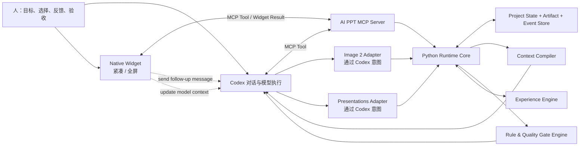

# AI PPT Studio Agent 原生工作台｜系统详细设计 v1.0

## 1. 文档信息

- 版本：v1.0 RC1
- 日期：2026-08-02
- 权威产品输入：[01-产品需求基线-v1.0.md](./01-产品需求基线-v1.0.md)
- 产品项目根目录：`/Users/defei/Documents/我的空间/workspace/memory/产品研究/PPT大师/PPT-codex-app`
- 源码根目录：`/Users/defei/Documents/我的空间/workspace/memory/产品研究/PPT大师/PPT-codex-app/产品代码`
- 运行数据根目录：默认 `/Users/defei/Documents/AI-PPT-Workspace`
- 设计目标：在不重写现有运行时的前提下，增加 Codex Native Widget、MCP 双向工作台、结构化认知地图和任务级上下文编译。
- 当前状态：`待用户最终评审，未进入实现`

## 2. 设计依据与事实边界

### 2.1 已验证的本地事实

现有 AI PPT Studio 已实现：

- `ProjectStore`：受管项目创建和恢复；
- `StateStore`：G0–G4 顺序状态和局部重开；
- `MaterialSource`：file/directory/url/text 输入与 reference/copy 模式；
- `ArtifactStore`：不可变、带哈希的版本化产物；
- `EventStore`：追加式事件；
- `ExperienceStore`：候选经验、跨项目应用、评价、晋级、禁用和回滚；
- HTML 审阅产物；
- 路径保护、安装和隔离验收测试。

本机 Cowart 0.1.20 验证了当前环境可行的 Native Widget 模式：

- 插件包含 `.codex-plugin/plugin.json`、Skill、MCP Server 和 Widget 资源；
- Widget 可通过 MCP Server Tool 读取/保存项目状态；
- Widget 可向 Codex 发送后续用户消息；
- Widget 可更新模型可见上下文；
- Widget 可请求内嵌/全屏显示模式，并在运行时读取宿主能力；
- Widget 数据可以保存到用户项目，而不是插件目录。

### 2.2 宿主能力边界

本设计不假设以下能力永久存在：

- 固定常驻右侧栏；
- 永久顶层应用入口；
- 任意尺寸和全屏模式必然可用；
- Widget 修改状态后自动触发新模型回合；
- Widget 能直接调用 Codex 内置 Image 2 或 Presentations；
- Widget 内存和 localStorage 在重挂载后可靠保留；
- 新插件版本无需重新加载任务即可获得新 MCP Schema。

所有宿主增强能力必须运行时探测；项目文件是唯一持久真相源。

本次在线官方文档刷新因网络中断未完成，因此研发不得把本机参考实现之外的宿主行为写成硬依赖。正式开发前需要重新执行一次官方文档与当前 Codex 宿主能力校验。

## 3. 架构原则

1. **AI 主导，系统治理**：AI 自主完成低风险工作，系统用状态门和质量合同限制结果。
2. **一个真相源**：项目状态、产物和版本只保存在受管项目目录；Widget、对话和 HTML 都是投影。
3. **页面与 AI 共用结构**：页面上的选择、决定、事实、推论和不确定性必须成为 AI 的结构化上下文。
4. **意图与执行分离**：Widget 负责提交意图；Codex 决定并调用 Image 2、Presentations 等当前可用能力。
5. **上下文按任务编译**：不把整个项目、所有历史和全部材料塞给模型。
6. **内容先于视觉**：G0 未通过，系统不能调度正式视觉设计。
7. **概念与工程双轨**：Image 2 证明视觉上限，工程样张证明 PPT 可实现性。
8. **可恢复**：长任务、网络失败、Widget 重挂载和模型中断均不得丢失上一有效版本。
9. **增量升级**：复用现有 Python 运行时和数据，不用新前端重写业务内核。
10. **能力探测与降级**：宿主能力不可用时，降级为内嵌视图、HTML 审阅或对话操作。

## 4. 总体架构



## 5. 组件设计

| 组件 ID | 组件 | 职责 | 主要依赖 |
|---|---|---|---|
| CMP-01 | Plugin Package | 声明插件、Skill、MCP、Widget、品牌与默认提示 | Codex 插件加载器 |
| CMP-02 | Native Widget UI | 显示五个认知空间、接收判断、请求对话和展示进度 | MCP Apps bridge |
| CMP-03 | MCP Server | 对 Widget 和 Codex 暴露统一工具与资源 | Runtime Facade |
| CMP-04 | Runtime Facade | 把 MCP 契约映射到现有 Python 运行时 | Project/State/Artifact/Event Store |
| CMP-05 | Project State Store | 保存规范化项目状态、认知地图、决定和当前工作 | 本地文件系统 |
| CMP-06 | Artifact Store | 保存任务书、蓝图、样张、合同、Scene Graph、PPTX 等不可变版本 | 现有 ArtifactStore |
| CMP-07 | Event Store | 追加式记录写入、任务、决定、冲突、回滚和质量门 | 现有 EventStore |
| CMP-08 | Rule & Gate Engine | 检查业务前置、G0–G4、人工暂停和写入权限 | 状态与产物 |
| CMP-09 | Context Compiler | 为当前 Agent Task 生成最小充分上下文包 | 状态、规则、来源、历史 |
| CMP-10 | Agent Intent Dispatcher | 将页面动作转成持久化意图和 Codex 后续消息 | MCP Server、Widget bridge |
| CMP-11 | Material Engine | 导入、解析、分类、提炼、冲突和来源定位 | 现有 materials 模块 + AI |
| CMP-12 | Blueprint Engine | 叙事、章节、逐页内容、引用、冻结和重开 | Artifact/Gate |
| CMP-13 | Visual Engine | Visual Brief、Concept Set、Visual Contract、Scene Graph | Image 2、AI、Presentations |
| CMP-14 | Delivery Engine | 构建、渲染、检查、差异、修复、G4 与交付包 | Presentations |
| CMP-15 | Experience Engine | 项目反馈、候选经验、应用、评价、晋级与回滚 | 现有 ExperienceStore |
| CMP-16 | Review Renderer | 生成离线 HTML、联系表和机器验收报告 | 项目产物 |

组件间只能通过明确对象和工具契约通信。Widget 不直接读写项目文件；MCP Server 不直接实现 PPTX 引擎；Skill 不保存项目状态。

## 6. 插件与目录结构

### 6.1 源码仓库目标结构

```text
PPT-codex-app/
├── 00-唯一研发基线索引-v1.0.md
├── 01-产品需求基线-v1.0.md
├── 02-系统详细设计-v1.0.md
├── 03-UI设计与交互规范-v1.0.md
├── AGENTS.md
└── 产品代码/
    ├── AGENTS.md
    ├── prototypes/
    ├── .codex-plugin/
    │   └── plugin.json
    ├── .mcp.json
    ├── skills/
    │   └── ai-ppt-studio/
    │       ├── SKILL.md
    │       ├── references/
    │       └── assets/
    ├── mcp/
    │   ├── server.mjs
    │   ├── tools/
    │   ├── resources/
    │   └── runtime-bridge/
    ├── widget/
    │   ├── src/
    │   ├── public/
    │   └── dist/
    ├── src/ai_ppt_studio/
    ├── schemas/
    ├── docs/superpowers/
    └── tests/
```

现有 `skill/ai-ppt-studio` 在迁移期继续保留。插件正式包建立后，只保留一个权威 Skill 源并由构建脚本复制，禁止维护两份手工内容。

### 6.2 运行数据结构

```text
AI-PPT-Workspace/
├── workspace.json
├── projects/
│   └── <project-slug>-<id>/
│       ├── project.json
│       ├── sources/
│       ├── managed-assets/
│       ├── cognition/
│       │   ├── mission.json
│       │   ├── map.json
│       │   ├── decisions.jsonl
│       │   └── uncertainties.json
│       ├── blueprint/
│       ├── visual/
│       ├── scene-graph/
│       ├── ppt/
│       ├── renders/
│       ├── reviews/
│       ├── state/
│       │   ├── state.json
│       │   ├── active-task.json
│       │   └── ui-projection.json
│       ├── events/
│       └── logs/
├── personal-memory/
├── inspiration-pool/
├── evaluation/
└── cache/
```

`cognition/` 与 `state/ui-projection.json` 是本次升级新增；旧项目没有时由迁移器生成，不能破坏旧文件。

### 6.3 技术栈决策

本次升级采用：

- Widget：React + TypeScript + Vite，构建为可内联的静态 HTML/CSS/JS 资源；
- Widget 样式：CSS Variables + 项目自有轻量组件，不引入完整 UI 框架；
- MCP Server：Node.js ESM + Model Context Protocol SDK / MCP Apps 扩展；
- 业务运行时：保留现有 Python 包 `ai_ppt_studio`；
- Schema：JSON Schema，Widget、MCP 和 Python 共享同一版本化契约；
- Python 测试：pytest；
- Widget 单元/组件测试：Vitest + Testing Library；
- MCP 契约测试：Node test/Vitest；
- 浏览器交互与截图：Playwright；
- PPTX 执行：Codex Presentations，不增加 `python-pptx` 或浏览器端 PPT 引擎。

生产插件不启动本地 Web Server。MCP Server 注册并返回已构建的 Widget 资源；本地 HTTP 只允许用于开发调试和截图验收。

### 6.4 Node 与 Python 边界

Node 负责 Codex/MCP/Widget 协议，Python 负责领域状态、路径、版本、规则和持久化。Phase A 使用最小可靠边界：

1. Node 将经过 Schema 校验的请求作为 JSON 传给专用 Python bridge command；
2. Python 调用现有 store/facade 并只向 stdout 输出一个结构化 JSON 结果；
3. stderr 仅用于诊断，错误转换为稳定 error code；
4. 每次写入由 Python 完成文件锁、revision 校验、原子写和事件追加；
5. Node 不复制业务规则，也不直接修改项目 JSON；
6. 大材料和模型任务由 Codex AgentTask 承担，不在 MCP 调用中阻塞执行。

先采用短生命周期 subprocess，保持实现简单、失败隔离和兼容现有 CLI。只有真实性能测试证明启动开销成为瓶颈时，才升级为长驻 worker；不得在 Phase A 预建复杂进程池。

## 7. 统一项目状态模型

### 7.1 ProjectWorkspaceState

```json
{
  "schemaVersion": "2.0",
  "projectId": "uuid",
  "revision": 42,
  "updatedAt": "ISO-8601",
  "activeSpace": "overview",
  "activeGate": "G0",
  "missionRef": "artifact://mission/v3",
  "cognitionMapRef": "cognition/map.json",
  "gateState": {},
  "artifactHeads": {},
  "activeTask": {},
  "deliveryStatus": {},
  "uiProjection": {},
  "lastHumanDecisionId": "decision-id"
}
```

### 7.2 CognitionMap

认知地图是 AI 对交付任务的外化、可审计模型，不保存隐藏思维链。包含：

| 字段 | 含义 |
|---|---|
| deliveryGoal | 要交付什么并促成什么结果 |
| audiences | 主要决策者、评审者、影响者和潜在否决者 |
| problems | 当前需要解决的问题及其类型 |
| facts | 用户事实和来源引用 |
| aiJudgments | AI 当前推论、依据、置信度、版本和更新时间 |
| recommendations | 建议动作、预期影响和可撤销性 |
| confirmedDecisions | 用户已确认决定及其范围 |
| uncertainties | 尚未澄清事项、影响范围和阻断级别 |
| affectedArtifacts | 哪些蓝图、页面、视觉合同或交付物受影响 |
| outcomeStatus | 当前成果、质量门和是否在轨 |
| dialogueFocus | 当前最值得讨论的一个认知节点 |

### 7.3 认知节点统一结构

```json
{
  "nodeId": "uuid",
  "type": "fact|inference|recommendation|decision|uncertainty|outcome",
  "title": "string",
  "summary": "string",
  "status": "active|confirmed|superseded|resolved|blocked",
  "confidence": 0.0,
  "sourceRefs": ["source://..."],
  "artifactRefs": ["artifact://..."],
  "dependsOn": ["node-id"],
  "affects": ["node-id", "artifact://..."],
  "createdBy": "user|ai|system",
  "confirmedBy": "user|null",
  "revision": 1,
  "updatedAt": "ISO-8601"
}
```

事实不要求 confidence；AI 推论必须有依据与 confidence；用户决定必须保存原始表达和结构化解释。

## 8. 核心对象详细契约

### 8.1 MissionBrief

必填：

- `topic`；
- `primaryAudience`；
- `desiredJudgmentOrAction`。

可选但必须显示未知影响：

- maker、secondaryAudiences、decisionStage、meetingMode、timeLimit、pageRange、brand、confidentiality、language、deliveryEnvironment、knownConsensus、openQuestions、concerns、competition、previousFeedback、redLines。

状态：`draft -> confirmable -> confirmed -> reopened -> superseded`。

### 8.2 MaterialSource / MaterialFinding

MaterialSource 复用现有 `kind/mode/original_ref/managed_ref/sha256/size/created_at`，新增：

- accessStatus；
- contentSnapshotRef；
- publisher/title/date/updatedAt/readAt；
- permissionScope；
- inferredPurposes[]；
- parseStatus；
- lastValidSnapshotRef。

MaterialFinding：

- findingId、findingType、content、sourceRef、locator、authorityLevel、confidence、factStatus、usableInSlides[]、conflictsWith[]、sanitizedReusableAssetRef。

### 8.3 ContentBlueprint / SlidePlan

ContentBlueprint：objective、audienceModel、persuasionLine、narrativePerspective、chapterOrder、slides[]、version、status、sourceCoverage、openIssues。

SlidePlan：

- slideId、order、chapterId、title；
- communicationGoal、coreClaim、visibleCopy、speakerNotes；
- factRefs、caseRefs、screenshotRefs、dataRefs；
- aiConnectiveContent；
- contentStatus；
- gaps、conflicts、downstreamImpact；
- confirmedBy、confirmedAt。

### 8.4 VisualBrief / ConceptSampleSet

VisualBrief：audienceFit、desiredPerception、designProposition、narrativeRhythm、visualGrammar、typographyIntent、colorIntent、imageryStrategy、diagramStrategy、brandConstraints、deliveryEnvironment、pptConstraints、avoidList。

ConceptSampleSet：concepts[]、commonTestSlides[]、imageRefs[]、selfCritique、mediaRouting、feasibilityRisks、userSelection、revision。

### 8.5 VisualContract

必须包含：

- selectedConceptId；
- designPrinciples；
- pageFamilies；
- gridAndCompositionRules；
- typographyTokens；
- colorTokens；
- image/diagram/chart/table treatment；
- density、rhythm、transition；
- nativePreferred、bitmapAllowed、forbiddenEffects；
- replacementAndFallbackRules；
- editableTargetByObjectType；
- engineeringSampleEvidence；
- approvedExceptions；
- contractVersion、frozenAt、frozenBy。

### 8.6 SlideSceneGraph

每页包含：

- semantic role；
- viewport / safe area；
- objects[]；
- parent/child、alignment、readingOrder、zOrder、anchors、constraints；
- content refs、source refs、asset refs；
- object role：native-required / native-preferred / controlled-bitmap / forbidden；
- editability、replaceability、crop behavior；
- accessibility label；
- render fallback；
- validation rules。

场景图是可控中间表示，不要求用户编辑，也不替代 PPTX。

### 8.7 AgentTask

```json
{
  "taskId": "uuid",
  "type": "classify-materials|generate-blueprint|explore-concepts|build-pptx|qa-render|repair",
  "projectId": "uuid",
  "requestedBy": "widget|codex|system",
  "expectedRevision": 42,
  "contextPackRef": "context/task-id.json",
  "inputRefs": [],
  "status": "queued|running|needs-user|partial|failed|cancelled|completed",
  "progress": {"stage":"rendering","done":18,"total":24},
  "resultRefs": [],
  "error": null,
  "retryCount": 0,
  "createdAt": "",
  "updatedAt": ""
}
```

## 9. 写入优先级与所有权

统一写入优先级：

1. 最新明确的用户决定；
2. 交付任务与成功标准；
3. 系统规则、状态门与质量合同；
4. 已确认事实和决定；
5. 来源证据；
6. AI 推论和建议；
7. 历史版本和会话摘要。

AI 不得覆盖更高优先级信息，只能提出冲突或生成新版本。页面不直接写产物文件，必须调用 MCP 工具并提供 `expectedRevision`。

## 10. MCP Server 契约

### 10.1 Widget 资源

`render_ai_ppt_workbench`

- 输入：projectRoot 或 projectId、initialSpace、requestedDisplayMode；
- 输出：MCP App resource，支持 inline/fullscreen capability detection；
- `_meta.widgetData`：初始项目快照、允许动作、能力标志和资源 URL；
- 不包含全部材料正文或完整历史。

### 10.2 读工具

| 工具 | 输入 | 输出 |
|---|---|---|
| get_project_snapshot | projectId, projection, sinceRevision? | 任务级或页面级快照 |
| get_cognition_map | projectId, nodeTypes?, depth? | 认知节点与依赖 |
| list_materials | projectId, filter, cursor | 材料和提炼摘要 |
| get_content_blueprint | projectId, chapterId?, slideId? | 蓝图摘要或详情 |
| get_visual_workspace | projectId, conceptId? | Visual Brief、方向、合同、工程样张 |
| get_delivery_review | projectId, buildId? | 构建、渲染、问题和交付门 |
| get_artifact_version | artifactRef | 指定不可变版本 |
| list_project_events | projectId, afterCursor? | 增量事件 |

### 10.3 写工具

| 工具 | 核心输入 | 副作用 |
|---|---|---|
| patch_project_state | projectId, expectedRevision, patch, reason | 原子写入新 revision，追加事件 |
| submit_human_decision | projectId, targetRef, choice/feedback, expectedRevision | 创建决定、更新认知图、计算影响范围 |
| request_agent_action | projectId, actionType, targetRefs, instructions | 创建 AgentIntent/Task，返回 followUpMessage |
| append_feedback | projectId, scope, rawText, targetVersion | 保存原始反馈和待解释任务 |
| confirm_gate | projectId, gate, evidenceRefs, expectedRevision | 通过人工质量门 |
| reopen_scope | projectId, gate, artifactRefs, reason | 局部重开、锁定下游受影响部分 |
| cancel_agent_task | projectId, taskId | 标记取消，保留已完成产物 |
| restore_artifact_version | projectId, artifactRef, reason | 创建指向旧内容的新版本，不改历史 |

### 10.4 响应约定

每个工具返回：

- `structuredContent`：Codex 可读的精简结果；
- `_meta.widgetData`：Widget 更新需要的投影；
- `revision`；
- `eventCursor`；
- `allowedNextActions`；
- `conflict` 或 `userAttention`（如有）。

错误不使用自由文本作为唯一判断依据，必须返回稳定 error code。

## 11. 双向回写机制

### 11.1 Widget → 项目状态

1. 用户在 Widget 中选择、确认或提交反馈；
2. Widget 调用 MCP 写工具，携带当前 revision；
3. MCP Server 校验权限、规则和版本；
4. Runtime 原子写入状态/产物，追加事件；
5. 返回新投影；
6. Widget 更新页面；
7. 如果动作需要 AI 执行，Widget 使用返回的 follow-up message 发送到 Codex。

### 11.2 Widget → 模型上下文

页面状态变化本身不等于模型已开始工作。

- `updateModelContext`：用于把当前选择、活动对象和认知焦点提供给当前模型上下文；失败不影响持久状态；
- `sendFollowUpMessage`：用于明确触发一个新的 Codex 用户回合；
- 任何调用前先保存持久状态；
- 宿主不支持时显示“已保存，返回对话继续”，不得假装 AI 已开始。

### 11.3 Codex → 项目状态

1. Codex 读取 AgentTask 的 Context Pack；
2. 调用 Image 2/Presentations/文件工具完成工作；
3. 将产物写入受管项目；
4. 调用 MCP/Runtime 提交结果、问题和质量状态；
5. 状态写入新 revision 并追加事件；
6. Widget 通过 tool result、增量刷新或重新打开获取更新。

### 11.4 冲突

使用乐观并发控制：

- 每个写入携带 `expectedRevision`；
- 不匹配时返回 `REVISION_CONFLICT` 和最新投影；
- 不自动覆盖用户决定；
- 非重叠 UI 偏好可自动重放；
- 同一业务对象冲突要求 AI 合并建议或人工选择。

## 12. Context Compiler

### 12.1 目标

每个 AgentTask 获得“最小充分上下文”，而不是全部项目文件。

### 12.2 Context Pack 结构

```text
1. Task objective and expected deliverable
2. Relevant product/system rules
3. Current gate and allowed transitions
4. Mission and audience subset
5. Confirmed facts and decisions
6. Evidence/source excerpts required for this task
7. Current artifact contract and target version
8. Active uncertainties and impact
9. Applicable personal experience with version and reason
10. Output schema, validation and write-back instructions
11. Explicit exclusions
```

### 12.3 编译规则

- 先按 taskType 路由，再按 targetRefs 收集；
- 只包含关联事实和来源摘录；
- 历史只包含上一有效版本与当前差异；
- 用户原始决定优先于会话摘要；
- 每个 Context Pack 带 projectRevision、artifactVersion 和生成时间；
- Pack 保存到项目以支持复现和审计；
- 不保存隐藏思维链，只保存任务输入、外化判断和依据。

## 13. 规则与人工暂停引擎

### 13.1 影响级别

| 级别 | 示例 | 默认行为 |
|---|---|---|
| L0 只读 | 摘要、分类、查看 | 直接执行 |
| L1 可撤销低影响 | 标签、页面状态、布局微调 | 自动执行并回执 |
| L2 建议 | 下一步、视觉方向、内容改写 | 生成候选，可继续探索 |
| L3 高影响 | 目标、事实、页数、方案边界、视觉合同 | 人工确认后写入 |
| L4 破坏性/对外 | 删除、覆盖、批量、发送、最终交付 | 强确认、权限、审计 |

### 13.2 暂停判定

暂停条件来自：影响级别、置信度、来源冲突、可撤销性、状态门、用户显式规则。任何单一页面不得自行改变暂停政策。

## 14. G0–G4 技术状态

现有 `StateStore` 的 gate 结构继续作为主状态机，升级后增加 gate evidence、scope 和 approval：

```json
{
  "G0": {
    "status": "open|passed|locked",
    "scopeRefs": [],
    "evidenceRefs": [],
    "approvedBy": "user|null",
    "approvedAt": "",
    "reopenReason": null
  }
}
```

局部重开时：

- 受影响 artifact head 标记 stale；
- 下游任务停止继续写入；
- 未受影响产物保持可用；
- 认知地图显示影响路径；
- 修复后重新完成相关 gate，不要求全部重做。

## 15. Image 2 与 Presentations 路由

### 15.1 Widget 不直接调用

Widget 只提交：

- 视觉任务意图；
- 选中方向/页面/素材；
- 用户反馈；
- 目标纵横比和约束。

Codex 根据当前可用工具调用 Image 2 或 Presentations，并把结果写回项目。

### 15.2 Image 2

- 用于概念方向、关键样张、素材处理和视觉探索；
- 生成失败时保留任务和最后有效样张；
- 结果必须记录 prompt、参考图、目标页面、版本和使用边界；
- 生成图中文字不作为正式事实；
- 视觉合同必须解释可实现机制。

### 15.3 Presentations

- 是所有 PPTX 读取、创建、编辑、渲染和检查的唯一执行路线；
- Runtime 只编排输入、产物、质量状态和版本，不实现第二套 PPT 引擎；
- 禁止 `python-pptx` 等并行生产路径；
- 每次构建保存 PresentationBuild、渲染证据和工具版本信息。

## 16. 长任务与异步恢复

任务状态：

```text
queued -> running -> completed
                  -> needs-user
                  -> partial
                  -> failed
                  -> cancelled
```

规则：

- 用户可关闭 Widget 或离开任务；
- 每个阶段写 progress checkpoint；
- partial 保留已完成结果；
- failed 保存可诊断 error、lastValidResult 和 retryPolicy；
- retry 必须幂等，不重复导入或覆盖产物；
- 网络失败使用指数退避和用户可见重试；
- 任务完成不自动等于通过质量门。

## 17. 错误代码

| 代码 | 含义 | 恢复 |
|---|---|---|
| PROJECT_NOT_FOUND | 项目不存在或不受管 | 选择/创建受管项目 |
| PATH_PROTECTED | 写入目标在保护根 | 更换运行根，不得绕过 |
| REVISION_CONFLICT | 写入版本已变化 | 刷新并合并/选择 |
| GATE_BLOCKED | 前置状态门未通过 | 返回受影响空间 |
| SOURCE_UNREADABLE | 文件/链接无法读取 | 重试、重新授权或替换 |
| SOURCE_CONFLICT | 关键来源冲突 | AI 推荐 + 人工确认 |
| HOST_CAPABILITY_UNAVAILABLE | 宿主不支持目标模式/桥接 | 降级视图或返回对话 |
| AGENT_TURN_REQUIRED | 状态已保存但需要新模型回合 | 发送 follow-up message |
| IMAGE_GENERATION_FAILED | Image 2 失败 | 保留任务和上一结果，重试 |
| PRESENTATION_BUILD_FAILED | PPTX 构建失败 | 局部重编译/恢复上一构建 |
| QA_GATE_FAILED | 硬质量门失败 | 展示问题并阻止交付 |
| CONTEXT_STALE | Context Pack 与项目版本不一致 | 重新编译上下文 |

## 18. 安全、隐私与隔离

1. 四区隔离继续有效：本 Agent 产品项目及其 `产品代码/`、并行 Web 产品空间、Codex 安装目录、用户运行数据；
2. 原始材料只读引用，需处理时复制到受管项目；
3. 不覆盖、移动或删除原材料；
4. 所有写入先经过 `PathPolicy` 真实路径解析；
5. Widget 只通过 MCP 访问项目，不直接暴露任意文件系统；
6. Tool 参数对路径、ID、文件名和 MIME 类型做白名单/边界校验；
7. 对外发送、导出到非默认路径和删除必须明确授权；
8. 事件日志不保存密钥；
9. 项目内容来源只允许用户主动提供的文件、目录、文字、图片和链接；AI 不主动搜索互联网补充客户项目材料；
10. 用户材料可以按任务需要用于 Image 2，本产品不设置额外隐私阻断门；
11. 经验机制必须净化客户标识，不跨用户发布私人材料。

## 19. 非功能要求

### 19.1 性能

- Widget 首次可用投影：本地项目 2 秒内；
- 页面切换：已有投影 200ms 内；
- 增量状态刷新：本地写入后 1 秒内可见；
- 大材料解析和 PPT 构建使用长任务，不阻塞 Widget；
- 联系表和列表分页/虚拟化，避免一次加载全部大图。

模型与 Image 2 外部耗时单独显示，不作为本地 UI 性能失败。

### 19.2 可靠性

- 原子写 JSON；
- 产物不可变版本；
- 事件追加式；
- 每次正式写入带 revision；
- 失败不破坏上一有效版本；
- 项目可复制、备份和恢复；
- Skill/插件重装不删除运行数据。

### 19.3 可观察性

- 每个 AgentTask、tool call、gate transition 和 artifact version 有 ID；
- 用户看到业务进度，研发日志保存在 `logs/`；
- 交付报告含质量检查、失败和修复摘要；
- 不向普通用户展示原始模型思维链或开发控制台。

## 20. 迁移设计

### 20.1 兼容策略

- 现有 schema 1.0 项目可继续用 CLI/Skill 恢复；
- 首次由 Widget 打开时运行只增不删的 1.0 → 2.0 迁移；
- 保留旧 state.json 备份或可重建来源；
- 旧 G0–G4 状态映射到新 gateState；
- 旧 artifacts 直接成为 artifactHeads；
- 旧事件保持不变，新事件追加；
- 迁移失败时回退只读，不修改原项目。

### 20.2 源码升级顺序

1. 抽象 Runtime Facade；
2. 增加 schema 2.0 和迁移器；
3. 增加 MCP Server 读工具；
4. 增加 Widget 项目总览只读投影；
5. 增加写入、revision 和 decision；
6. 增加 follow-up intent 和 Context Compiler；
7. 依次接通材料、蓝图、视觉、交付；
8. 打包插件并保留现有 Skill 入口；
9. 用现有冒烟项目做升级验收。

## 21. 测试策略

### 21.1 单元测试

- schema 校验与迁移；
- 认知节点状态；
- revision 冲突；
- 写入优先级；
- gate pause/reopen；
- Context Pack 选择与排除；
- error code；
- 路径保护；
- 经验晋级边界。

### 21.2 契约测试

- MCP tool input/output schema；
- Widget resource metadata；
- structuredContent 与 widgetData 一致；
- follow-up intent 不丢失；
- 宿主 capability 缺失降级；
- schema 1.0 项目兼容。

### 21.3 端到端测试

1. 安装插件并打开项目；
2. 紧凑视图切换全屏；
3. 页面提交决定并持久化；
4. 发送 follow-up 到 Codex；
5. Codex 读取 Context Pack、写回产物；
6. Widget 读取新版本；
7. 并发修改产生冲突而非覆盖；
8. Widget 重挂载恢复；
9. Image 2 失败、Presentations 失败和网络断开恢复；
10. 一个真实售前项目通过 G0–G4 并交付。

### 21.4 UI/视觉测试

- 1440×1024 全屏；
- 360–480px 紧凑宽度；
- 长中文、长文件名、24/60/120 页项目；
- 空、加载、部分失败、冲突、无权限；
- 键盘、焦点、对比度和缩放；
- 截图与 UI 基线对照。

## 22. 研发阶段

### Phase A：双向状态最小闭环

- 插件包、MCP Server、Widget 壳；
- 项目总览；
- get/patch state；
- decision；
- follow-up message；
- compact/fullscreen capability detection；
- 现有项目恢复。

### Phase B：内容闭环

- 任务书；
- 材料工作台；
- 内容蓝图；
- Context Compiler；
- G0。

### Phase C：视觉闭环

- Visual Brief；
- Image 2 意图；
- 方向与代表样张；
- 工程样张；
- Visual Contract / Scene Graph；
- G1–G3。

### Phase D：制作与交付闭环

- Presentations 构建；
- 渲染与 QA；
- 自动修复；
- G4；
- 交付包。

### Phase E：经验闭环与硬化

- 项目反馈；
- 候选经验；
- 跨项目评价；
- 安装、升级、兼容、性能和失败恢复。

每个阶段必须形成可运行垂直切片，不以只完成 UI 或只完成 schema 宣称闭环。

## 23. 实施前待验证

以下为技术验证项，不要求用户做技术选择：

1. 当前 Codex 版本的 Widget inline/fullscreen 能力和尺寸行为；
2. `updateModelContext` 与 `sendMessage` 的当前稳定契约；
3. Widget tool-result 增量通知；
4. 插件升级后是否必须新建任务加载新 Schema；
5. Codex Presentations 在当前环境的可调用边界；
6. Image 2 网络失败与重试行为；
7. Node MCP Server 调用 Python Runtime 的最佳进程模式；
8. 真实 60+ 页项目的投影性能。

验证失败时按能力探测与降级原则处理，不自动扩大产品范围。
